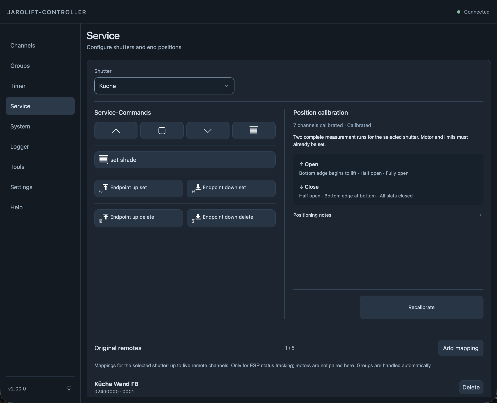
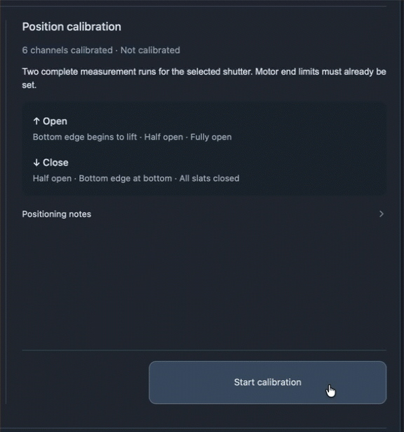

# Positionssteuerung und Kalibrierung

Die optionale Positionssteuerung ermöglicht eine prozentuale Öffnung der Rollläden über die WebUI, MQTT und Home Assistant. Diese Anleitung ergänzt die [Projektbeschreibung](../README_DE.md).

**0 % bedeutet vollständig geschlossen, 100 % vollständig geöffnet.** Gemeint ist die Öffnungshöhe, nicht der Lamellenabstand. Die Motoren liefern keine Positions- oder Endlagenrückmeldung. Alle angezeigten Positionen sind deshalb zeitbasierte Schätzungen.

## Warum jede Prozentfahrt eine Referenzfahrt benötigt

Eine reine Zeitsteuerung muss wissen, von welcher Position sie startet. Ein gespeicherter Prozentwert reicht dafür nicht zuverlässig aus: Der Rollladen kann seitdem mit einer Originalfernbedienung oder direkt vor Ort über einen elektrischen Taster bedient worden sein. Auch ein Neustart oder ein nicht empfangener Funkbefehl macht den bisherigen Stand unsicher.

Das Mitlesen zugeordneter Originalfernbedienungen hilft, bekannte Bedienvorgänge zu berücksichtigen. Es ersetzt die Referenzfahrt aber nicht:

- Ein Funksignal kann außerhalb der Reichweite liegen oder durch Störungen verloren gehen.
- Eine elektrische Vor-Ort-Bedienung sendet gegebenenfalls überhaupt kein Funksignal an den ESP.
- Der ESP kann einen gesendeten Befehl beobachten, aber nicht bestätigen, dass der Motor ihn empfangen und die erwartete Bewegung vollständig ausgeführt hat.

Deshalb fährt **jede Zwischenposition zuerst eine Endlage an**, auch wenn bereits ein Prozentwert angezeigt wird. Der ESP wartet die vollständige kalibrierte Fahrzeit mit Reserve ab. Die Endlage wird durch die bereits eingerichtete Endabschaltung des Motors bestimmt; der ESP erkennt sie nicht durch einen Sensor. Anschließend startet die berechnete Teilfahrt aus dieser definierten Ausgangslage.

| Gewünschte Öffnung | Ablauf |
| --- | --- |
| 0 % | Vollständig schließen, einschließlich Lamellenschluss. |
| Größer 0 %, unter 50 % | Vollständig schließen → kurze Pause → bis zum Ziel öffnen. |
| Ab 50 %, unter 100 % | Vollständig öffnen → kurze Pause → bis zum Ziel schließen. |
| 100 % | Vollständig öffnen. |

Beispiel: Für **25 %** fährt der Rollladen zuerst vollständig zu und öffnet anschließend ein Viertel seiner Höhe. Für **75 %** fährt er zuerst vollständig auf und schließt anschließend bis auf drei Viertel Öffnung. Für genau **50 %** wird die obere Endlage als Referenz verwendet.

**0 % und 100 %** senden direkt AB beziehungsweise AUF. Die Motorfahrt blockiert keine weiteren Endlagenanforderungen; mehrere Rollläden können dadurch nacheinander ihre Funkbefehle erhalten und gleichzeitig fahren. Die Positionsschätzung bleibt bis zum Ablauf der Fahrzeit unbekannt. Während einer laufenden Zwischenpositionsfahrt warten weitere Ziele weiterhin in der Warteschlange, damit deren zeitkritischer STOP nicht verzögert wird.

Die Referenzzeit entspricht der vollen Fahrzeit zuzüglich **5 % Reserve**, mindestens einer und höchstens drei Sekunden. Vor dem Richtungswechsel wartet der ESP **600 ms**. Auch wenn der Rollladen bereits nahe der Endlage steht, wird die volle Referenzzeit abgewartet. Das dauert länger, vermeidet aber das Vertrauen auf eine möglicherweise veraltete Position.

Die Referenzfahrt verbessert die Wiederholbarkeit unter normalen Betriebsbedingungen. Sie ist keine Positionsmessung und gleicht beispielsweise einen blockierten Motor, einen verpassten Funkbefehl oder eine gleichzeitige unbemerkte Vor-Ort-Bedienung während der Fahrt nicht aus.

## Wie die Fahrzeit zur Öffnungshöhe passt

Der Rollladen bewegt sich nicht über die gesamte Laufzeit gleichmäßig:

- Beim Öffnen wird zunächst der Panzer angezogen beziehungsweise werden die Lamellen auseinandergezogen, bevor sich die Unterkante anhebt.
- Beim Schließen erreicht die Unterkante zuerst den unteren Anschlag; danach läuft der Motor weiter, bis die Lamellen aufeinanderliegen.
- Beim Auf- und Abwickeln verändert sich der Wickeldurchmesser. Die halbe Laufzeit entspricht deshalb nicht zwingend der halben Öffnungshöhe.

Die Kalibrierung erfasst **drei Zeitpunkte je Richtung**. Öffnen und Schließen besitzen getrennte Kennlinien. Zwischen den erfassten Höhenmarken interpoliert der ESP die benötigte Zeit linear. Das berücksichtigt die Totzeiten und nähert den Einfluss des Wickeldurchmessers an, ohne ein komplexes mechanisches Modell oder zusätzliche Sensoren zu benötigen.

Die Teilfahrt endet mit einem STOP-Funkbefehl. Die Implementierung berücksichtigt dafür einen Vorlauf von **110 ms**, damit das Telegramm rechtzeitig am Motor ankommen kann. Kalibrierung, Funkübertragung und mechanische Unterschiede begrenzen weiterhin die Genauigkeit. Prozentwerte sind keine millimetergenaue Positionierung.

## Aktivieren und im WebUI bedienen

1. Unter **Einstellungen → Gerät → Positionssteuerung** die Funktion global einschalten.
2. Jeden gewünschten Rollladen einzeln auf der **Service-Seite** kalibrieren.
3. Unter **Kanäle** am kalibrierten Rollladen den Sollwert über den Slider einstellen und mit dem Ausführen-Button bestätigen. Das Verschieben des Sliders allein startet keine Fahrt.

Bei ausgeschalteter Funktion bleibt der zusätzliche Positionsbereich ausgeblendet. Ist die Funktion eingeschaltet, aber ein Rollladen nicht kalibriert, erscheint nur „Nicht kalibriert“ mit einem Link zur Kalibrierung. Die normalen Tasten AUF, STOP, AB und SCHATTEN bleiben nutzbar. Es müssen nicht alle Rollläden kalibriert werden.

## Ablauf der Kalibrierung

### Vorbereitung

Die tatsächlichen Endlagen des Motors müssen vorher korrekt eingerichtet sein. Die Positionskalibrierung ersetzt das Einstellen dieser Endlagen nicht. Änderungen an der Mechanik oder den Endlagen erfordern eine erneute Kalibrierung.

Den Rollladen während des gesamten Ablaufs direkt beobachten. Die halbe Öffnungshöhe vorher markieren: Maßgeblich ist die Position der Unterkante zwischen vollständig abgesenktem und vollständig geöffnetem Panzer. Die Markierung hilft, denselben Punkt in beiden Richtungen zu treffen.

Auf der **Service-Seite** den gewünschten aktivierten Rollladen auswählen. Dieselbe Auswahl gilt für die Service-Befehle, die Kalibrierung und die Originalfernbedienungszuordnung.

### Schritt für Schritt

1. Den Rollladen mit den normalen Tasten vollständig schließen. Warten, bis auch die Lamellen geschlossen sind.
2. **Kalibrierung starten** öffnen und die vollständig geschlossene Ausgangslage bestätigen.
3. Die Öffnungsfahrt starten und nacheinander bestätigen:
   - **Panzer hebt sich an:** Die Unterkante beginnt sich tatsächlich anzuheben.
   - **Halb geöffnet:** Die Unterkante erreicht die zuvor markierte halbe Öffnungshöhe.
   - **Vollständig geöffnet:** Der Rollladen hat seine obere Endlage erreicht.
4. Die Schließfahrt aus der vollständig geöffneten Lage starten und nacheinander bestätigen:
   - **Halb geöffnet:** Dieselbe Höhenmarkierung wird erreicht.
   - **Panzer unten:** Die Unterkante ist unten angekommen, die Lamellen sind noch nicht vollständig geschlossen.
   - **Lamellen vollständig geschlossen:** Der Panzer ist vollständig geschlossen und die untere Endlage erreicht.
5. Die erfassten Zeiten prüfen und ausdrücklich **übernehmen**. Erst dadurch werden vorhandene Kalibrierdaten ersetzt und in `config.json` gespeichert.

Der Bestätigungsbutton bleibt während des Assistenten an derselben Stelle, damit der Blick auf dem Rollladen bleiben kann.

Die angezeigten Zeiten werden ab Beginn der jeweiligen Fahrt gemessen. Es sind keine einzelnen Segmentdauern. Pro Richtung sind maximal **180 Sekunden** vorgesehen. Die Höhenmarken müssen zeitlich auseinanderliegen; für die wesentlichen Höhenabschnitte wird ein Abstand von mindestens **0,5 Sekunden** geprüft. Unplausible Daten können nicht übernommen werden.

Die Seite während der Kalibrierung im Vordergrund lassen. Der Browser sendet Lebenszeichen. Bleiben diese länger als **sechs Sekunden** aus, wird die Sitzung abgebrochen; während einer Kalibrierfahrt sendet der ESP STOP. Ein ausgefallener ESP oder ein nicht empfangener STOP-Befehl kann damit nicht abgesichert werden. Ein Verbindungsabbruch bedeutet daher keinen garantierten sofortigen Stopp.

### Ergebnis prüfen

Nach dem Speichern zunächst **25 %, 50 % und 75 %** testen, jeweils auch aus einer anderen Ausgangsposition. Kleine Abweichungen sind bei Zeitsteuerung möglich. Bei deutlich falschen Positionen zuerst die erfassten Höhenpunkte, Funkempfang und Motor-Endlagen prüfen und gegebenenfalls neu kalibrieren.

## Ansteuerung und Status über MQTT

`<prefix>` bezeichnet das in den MQTT-Einstellungen konfigurierte Basistopic. Die Rollladennummern reichen von **1 bis 16**.

### Prozentziel senden

| Topic | Payload | Bedeutung |
| --- | --- | --- |
| `<prefix>/cmd/position/1` | `25` | Rollladen 1 nach Referenzfahrt auf 25 % Öffnung fahren. |
| `<prefix>/cmd/position/1` | `0` | Vollständig schließen. |
| `<prefix>/cmd/position/1` | `100` | Vollständig öffnen. |

Die Payload ist eine **Ganzzahl von 0 bis 100**, ohne Prozentzeichen oder JSON-Objekt. Bewegungsbefehle **ohne Retain** senden, damit sie nach einem erneuten Verbinden nicht ungewollt wiederholt werden.

Voraussetzungen sind eine global eingeschaltete Positionssteuerung sowie ein aktivierter und kalibrierter Kanal. Im Setup-Mode, während OTA oder einer Kalibrierung sowie bei anstehenden manuellen Funkbefehlen werden keine Prozentziele angenommen. Eine abgewiesene Anforderung wird über `<prefix>/message` mit `invalid or unavailable position target` gemeldet. Prozentziele für Gruppen sind derzeit nicht vorgesehen.

### Mehrere Ziele nacheinander ausführen

WebUI, MQTT und Home Assistant nutzen denselben festen RAM-Puffer für **bis zu 16 wartende Aufträge zusätzlich zur laufenden Fahrt**. Die Motorfahrten werden nacheinander ausgeführt, jeweils mit eigener Referenzfahrt. Pro Rollladen bleibt höchstens ein Auftrag im Puffer; ein neuer Sollwert ersetzt dessen wartenden Wert, ohne den Platz zu verändern. Ein neuer Auftrag für den bereits fahrenden Rollladen wird hinter der laufenden Fahrt eingereiht und verändert diese nicht.

Im WebUI können während einer Fahrt Ziele für andere kalibrierte Rollläden vorgegeben werden. **„Ziel · wartet“ in der Beschriftungszeile und ein Spinner anstelle des Play-Symbols** kennzeichnen angenommene Aufträge ohne zusätzliche Textzeile. Der Button-Tooltip zeigt den eingereihten Zielwert und den Platz im Puffer; der Button bleibt zum Ändern eines wartenden Ziels bedienbar. Der aktuelle Öffnungsstatus bleibt davon getrennt und wird nicht auf den wartenden Zielwert gesetzt. Noch wartende Ziele lassen sich über den Slider und Ausführen erneut ändern. Eine Kalibrierung kann erst bei leerem Puffer gestartet werden.

Vor jedem Start prüft der ESP erneut, ob der Kanal aktiviert und gültig kalibriert ist. Nicht mehr verfügbare Kanäle werden übersprungen. Ein Fehler beim Senden beendet die automatische Verarbeitung und verwirft den Rest. Normale manuelle Befehle leeren den Puffer und brechen die aktive automatische Fahrt ab. Ein empfangener zugeordneter Originalfernbedienungsbefehl leert ebenfalls den Puffer; die aktive Fahrt wird dabei nur abgebrochen, wenn ihr Rollladen betroffen ist.

Der Puffer bleibt beim Browser-Refresh oder Schließen des Browsers am ESP erhalten. Er wird nicht in der Konfiguration gespeichert und nach Neustart, OTA, Setup-Mode oder Abschalten der Positionssteuerung nicht fortgesetzt.

### Normale Befehle

Die vorhandenen Befehle bleiben unverändert:

| Topic | Payload | Funktion |
| --- | --- | --- |
| `<prefix>/cmd/shutter/1` | `UP` oder `OPEN` oder `0` | Öffnen. |
| `<prefix>/cmd/shutter/1` | `DOWN` oder `CLOSE` oder `1` | Schließen. |
| `<prefix>/cmd/shutter/1` | `STOP` oder `2` | Anhalten. |
| `<prefix>/cmd/shutter/1` | `SHADE` oder `3` | Motorseitig gespeicherte Schattenposition anfahren. |

**Befehlskennungen sind keine Prozentwerte:** `0` auf `cmd/shutter/1` bedeutet AUF, während `0` auf `cmd/position/1` vollständig geschlossen bedeutet.

### Positionsstatus empfangen

Der gemeinsame Status für WebUI und MQTT wird unter **`<prefix>/status/shutter/1`** veröffentlicht:

| Payload | Bedeutung |
| --- | --- |
| `0` | Geschätzte Position vollständig geschlossen. |
| `1` bis `99` | Geschätzte Öffnung nach einer Prozentfahrt. |
| `100` | Geschätzte Position vollständig geöffnet. |
| `None` | Position unbekannt. |

Statusmeldungen werden **retained** veröffentlicht. Beim MQTT-Reconnect wird der aktuelle Stand erneut gesendet. Während einer automatischen Zielanfahrt bleibt die Positionsschätzung unbekannt; es wird kein fortlaufender gemessener Prozentwert übertragen. Nach abgeschlossener Zielanfahrt wird der Zielwert veröffentlicht, sofern die STOP-Übertragung erfolgreich gemeldet wurde. Das ist keine Empfangsbestätigung des Motors.

Nach STOP, SCHATTEN oder Neustart ist die Position unbekannt. Bei kalibrierten Rollläden wird nach normalem AUF/AB erst nach voller Fahrzeit einschließlich Reserve die Endlage angenommen. Ohne gültige Kalibrierung wird bei AUF/AB sofort die erwartete Endlage gemeldet; dies ist ebenfalls keine Rückmeldung des Motors.

> [!IMPORTANT]
> Die Statusskala wurde gegenüber älteren Versionen umgedreht: **0 = geschlossen, 100 = geöffnet**. Bestehende MQTT-Automatisierungen müssen diese Änderung berücksichtigen. Die normalen Befehlskennungen bleiben unverändert.

## Ansteuerung und Status über Home Assistant

Unter **Einstellungen → Integrationen** zunächst MQTT konfigurieren und anschließend **Home Assistant** beziehungsweise Discovery aktivieren. Die vorhandenen Rollladen-Cover werden weiterverwendet; für die Prozentsteuerung ist kein zweites Gerät anzulegen.

Für einen Rollladen ergänzt Discovery die Prozentsteuerung nur, wenn die Funktion **global eingeschaltet** und der Kanal **gültig kalibriert** ist:

| Funktion im Cover | Verwendeter MQTT-Pfad |
| --- | --- |
| Öffnen / Schließen / Stoppen | `<prefix>/cmd/shutter/N` |
| Gewünschte Position setzen | `<prefix>/cmd/position/N` |
| Geschätzte Position lesen | `<prefix>/status/shutter/N` |

Im Cover einen Öffnungswert wählen beziehungsweise in einer Automatisierung eine Zielposition setzen. Auch hier gilt **0 % geschlossen, 100 % geöffnet** und es wird stets dieselbe Referenzfahrt wie im WebUI ausgeführt. AUF/AB/STOP bleiben unabhängig von der optionalen Prozentsteuerung verfügbar.

Wird die Funktion ausgeschaltet oder die Kalibrierung ungültig, entfernt Discovery die Prozentsteuerung für diesen Kanal wieder. Änderungen sowie ein MQTT-Reconnect aktualisieren die Discovery-Konfiguration.

Die Prozentanzeige in Home Assistant ist derselbe Schätzwert wie im WebUI. Bei `None` wird kein Ersatz-Prozentwert erfunden. Die Discovery-Vorlage ignoriert die nicht numerische Positionsmeldung; ein zuvor angezeigter Prozentwert kann deshalb als letzter bekannter Stand erhalten bleiben. Es werden keine gesonderten Zustände „öffnet“ oder „schließt“ übertragen. Eine sichtbare Zahl in Home Assistant bestätigt weder die tatsächliche Motorposition noch eine erfolgreich empfangene Funkübertragung.

## Originalfernbedienungen und andere Bedienwege

Originalfernbedienungen werden unter **Service → Rollladen auswählen → Originalfernbedienungen** zugeordnet. Der ESP registriert dabei einen bereits am Motor angelernten Einzelkanal; die echte Anlernung am Motor bleibt unverändert. Einzel- und passende Gruppenbefehle aktualisieren anschließend denselben Positionsstatus, auch wenn MQTT ausgeschaltet ist. Der Ablauf ist in der [Projektbeschreibung](../README_DE.md#originalfernbedienungen-zuordnen) erläutert; Beispiele enthält [remotes.md](remotes.md).

Ein empfangener zugeordneter Befehl für den gerade automatisch bewegten Rollladen bricht dessen Zielanfahrt beziehungsweise Kalibrierung ab. Der ESP verfolgt anschließend den neuen Befehl. Wiederholtelegramme derselben laufenden AUF-/AB-Fahrt starten die Wartezeit nicht ständig neu.

**Nicht beobachtbare Bedienung bleibt nicht beobachtbar.** Wird der Motor über einen elektrischen Taster oder eine nicht empfangene Fernbedienung bewegt, kann der angezeigte Stand veralten. Deshalb bleibt die Referenzfahrt auch bei eingerichteter Fernbedienungszuordnung erforderlich.

## Verhalten bei Abbruch und Neustart

- Es läuft höchstens eine automatische Zielanfahrt oder Kalibrierung gleichzeitig. Normale Steuerbefehle haben Vorrang und beenden eine laufende automatische Sequenz zuerst.
- Eine reguläre Prozentfahrt wird nach Annahme vom ESP ausgeführt und benötigt keinen geöffneten Browser. Für den Kalibrierungsassistenten gilt dagegen die Lebenszeichenprüfung.
- Nach einem Abbruch gibt es keinen automatischen Wiederanlauf; wartende Positionsaufträge werden verworfen.
- Kalibrierdaten bleiben über einen Neustart erhalten; die aktuelle Positionsschätzung wird nicht gespeichert und startet unbekannt.
- Motor-Anlern-/Entlernbefehle und Änderungen der Endlagen machen die zugehörige Kalibrierung ungültig.
- Abschalten der Positionssteuerung oder Beginn eines OTA-Updates beendet automatische Abläufe.

## Technische Grundlage

Die Zeitkennlinie und Referenzfahrt stehen in [positionModel.h](../include/positionModel.h), die Ablaufsteuerung und Statuspflege in [shutterPosition.cpp](../src/shutterPosition.cpp). MQTT-Ansteuerung und Discovery verwenden [mqttCustom.cpp](../src/mqttCustom.cpp) und [mqttDiscovery.cpp](../src/mqttDiscovery.cpp). Hinweise zum Funkempfang stehen in [RF-Empfang.md](RF-Empfang.md).
