<div align="center">


<h3 style="text-align: center;">ESP32-Jarolift-Controller</h3>
</div>

-----

**[🇩🇪 Deutsche Version der Beschreibung](README_DE.md)**

-----

<div align="center">

[](https://github.com/dewenni/ESP32-Jarolift-Controller/releases/latest)


[](https://github.com/dewenni/ESP32-Jarolift-Controller/stargazers/)

</div>

-----

<div align="center">
If you like this project, feel free to push the <b>[Star ⭐️]</b> button and click <b>[Watch 👁]</b> to stay updated.
<br><br>
And if you'd like to support my work, you can also<p>

[](https://github.com/sponsors/dewenni)

</div>

-----

# ESP32-Jarolift-Controller

Controlling Jarolift(TM) TDEF 433MHz radio shutters via **ESP32** and **CC1101** Transceiver Module in asynchronous mode.

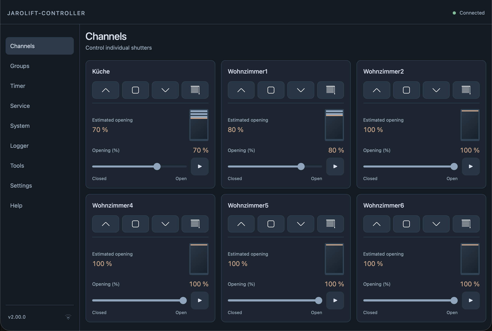

## Features

- **Web-based User Interface (WebUI):**  
A modern, mobile-friendly interface for easy configuration and control.

- **MQTT Support:**  
Communication and control of devices are handled via MQTT, a lightweight and reliable messaging protocol.

- **HomeAssistant Integration:**  
Automatic device discovery in HomeAssistant through MQTT Auto Discovery for seamless integration.

- **Support for up to 16 Roller Shutters:**  
Control up to 16 roller shutters with ease, all managed through the WebUI and MQTT.

- **Support for up to 6 Roller Shutter Groups:**  
define shutter groups to control several shutters at once

- **Timer function**  
stand alone timer function with fixed time, sunrise or sunset as trigger.

- **Time-based percentage positioning:**
Optional percentage targets with a reference run and per-shutter calibration. WebUI, MQTT and Home Assistant share the estimated opening: 0% closed, 100% open.

- **Original remote registration:**
Assign captured single channels to one or several shutters on the Service page. Received individual and group commands update the shared status.

### WebUI-Demo

For a first impression of the functions and the WebUI, a limited demo is also available.  
This can be accessed via the following link: [WebUI-DEMO](https://dewenni.github.io/ESP32-Jarolift-Controller/)

Experimental version.
Use at your own risk. For private/educational use only. (Keeloq algorithm licensed only to TI Microcontrollers)
This project is not affiliated in any way with the vendor of the Jarolift components.
Jarolift is a Trademark of Schöneberger Rolladenfabrik GmbH & Co. KG

This version is for an ESP32 and is based on ideas and code from [madmartin/Jarolift_MQTT](https://github.com/madmartin/Jarolift_MQTT).

### Project Homepage, Forum and Author

The original control code was written from Steffen Hille in Nov, 2017

The project home is here: [Project Home](http://www.bastelbudenbuben.de/2017/04/25/protokollanalyse-von-jarolift-tdef-motoren/)

-----

# Table of Contents

- [Hardware](#hardware)
  - [ESP32](#esp32)
  - [CC1101 433Mhz](#cc1101-433mhz)
  - [Optional: Ethernet Module W5500](#optional-ethernet-module-w5500)
- [Getting started](#getting-started)
  - [Platform-IO](#platform-io)
  - [ESP-Flash-Tool](#esp-flash-tool)
  - [OTA-Updates](#ota-updates)
  - [Setup-Mode](#setup-mode)
  - [Access and passwords](#access-and-passwords)
  - [Configuration](#configuration)
  - [Config Import and Export](#config-import-and-export)
    - [Base serial migration](#base-serial-migration)
  - [Teach-in of roller shutters](#teach-in-of-roller-shutters)
  - [Migration](#migration)
- [WebUI](#webui)
  - [Channels](#channels)
  - [Groups](#groups)
  - [Timer](#timer)
  - [Service](#service)
  - [Percentage positioning](#percentage-positioning)
  - [Original remote registration](#original-remote-registration)
- [MQTT](#mqtt)
  - [Commands](#commands)
  - [Status](#status)
  - [Home Assistant](#home-assistant)
- [Optional Communication](#optional-communication)
  - [WebUI-Logger](#webui-logger)
  - [Telnet](#telnet)

-----

# Hardware

you can find working setups from users of this project here: [working setups](https://github.com/dewenni/ESP32-Jarolift-Controller/discussions/34)

## ESP32

The firmware is currently only available for the following chips:

**Standard ESP32 (Xtensa® 32-bit LX6, 4MB Flash)**

- `ESP32-WROOM-32 series` (e.g. WROOM, WROOM-32D, WROOM-32U)
- `ESP32-WROVER series` (e.g. WROVER, WROVER-B, WROVER-IE)
- `ESP32-MINI series`
- `ESP32-S2 series`
- `ESP32-S3 series`
- `ESP32-C3 series`

**Not compatible:**

- `ESP32-H series`
- `YB-ESP32-S3-ETH`
- `WT32-ETH01`

## CC1101 433Mhz

**compatible and tested products:**

- `EBYTE E07-M1101D-SMA V2.0`
- `CC1101 433MHZ Green`


a standard SPI GPIO configuration is:

| CC1101-Signal| ESP-GPIO|
|--------------|---------|
| VCC          | --      |
| GND          | --      |
| GD0          | 21      |
| GD2          | 22      |
| SCK/CLK      | 18      |
| MOSI         | 23      |
| MISO         | 19      |
| CS(N)        | 5       |


 


example with ESP32-Mini and CC1101


example for direct replacement with ESP32-Mini and the custom board from M. Maywald

## Optional: Ethernet Module W5500

It is also possible to connect a W5500 Ethernet module to the Board or a generic ESP32.  

**compatible and tested products:**

- `W5500` HanRun (HR911105A)
- `W5500 Lite` HanRun (HR961160C)


> [!IMPORTANT]
> The connection cable should be as short as possible (approx 10cm)

Example for generic ESP32-Mini (Standard SPI port is used by CC1101)

| Signal| GPIO |
|-------|------|
| CLK   | 25   |
| MOSI  | 26   |
| MISO  | 27   |
| CS    | 32   |
| INT   | 33   |
| RST   | 17   |

-----

# Getting started

## Platform-IO

The software is created with [Visual Studio Code](https://code.visualstudio.com) and the [pioarduino-Plugin](https://github.com/pioarduino/pioarduino-vscode-ide).  
After installing the software you can clone the project from GitHub or you can download it as zip and open it in PlatformIO.
Then adapt the `upload_port` and corresponding settings in `platformio.ini` to your USB-to-serial Adapter and upload the code to the ESP.

> [!NOTE]
> Python must also be installed in order to fully compile the project. The scripts folder contains, for instance, scripts for creating the web pages that are called when the project is compiled.

## ESP-Flash-Tool

In the releases, you can find also the binary of the Software. If you don´t want to use PlatformIO, you can also use the `esp32_jarolift_controller_flash_vx.x.x.bin` file and flash it directly on the ESP. This bin-file is already a merge with bootloader.bin, partitions.bin and the application.bin. You can flash this image an the ESP at address 0x00.  

**Windows**  
There are several tools available to flash binaries to the ESP.  
One of them is [espressif-flash-download-tool](https://www.espressif.com/en/support/download/other-tools)

**macOS/Linux**  
for Mac it is hard to find a tool with a graphical UI, but you can simple use the esptool.py:

1. open Terminal
2. install esptool: `pip install esptool`  
3. optional get the install path: `which esptool.py`  
4. set path: `export PATH="$PATH:/<path>/esptool.py"` (<- change <path> with result from 3.)
5. goto path where the bin file is located
6. get Device String: `ls /dev/tty* | grep usb` (use this in next Step for <UPLOAD-PORT>)
7. upload: `esptool.py -p <UPLOAD-PORT> write_flash 0x00 esp32_jarolift_controller_flash_vx.x.x.bin`  

## OTA-Updates

### local Web OTA-Update

Open **Tools → Firmware update → Local file**, select the OTA binary for your ESP variant and click **Install file**. For an ESP32, the release file is named `esp32_jarolift_ota_vX.Y.Z.bin`; other chip variants have their own prefix. Use the OTA file, not the complete `*_flash_*` image used for initial installation. Upload progress and the result appear on the Tools page.

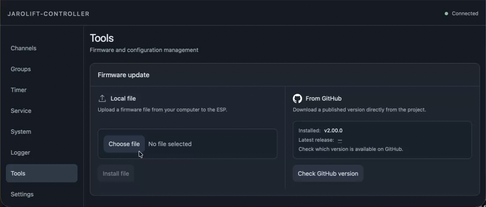

### GitHub OTA-Update

Open **Tools → Firmware update → From GitHub** and click **Check GitHub version**. The installed version, latest published release and availability of a matching OTA file are displayed directly on this page. A separate installation button appears when an installable release is found; checking alone does not start an update. Older releases are explicitly marked as a downgrade and require confirmation.

The version link in the navigation footer takes you to this section. Updates are no longer performed in a version popup.

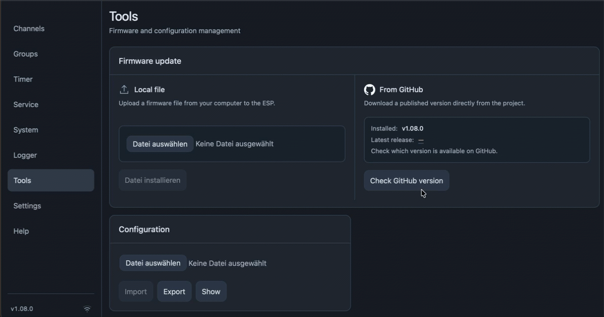

### PlatformIO OTA-Update

Wireless uploads via ArduinoOTA use the **service password**, independently of WebUI authentication. Set it under **Settings → Access & maintenance → Service access**. In normal operation, an empty service password disables ArduinoOTA; there is no default-password fallback.

In `platformio.ini`, use the appropriate environment and set:

```ini
upload_protocol = espota
upload_port = <ESP-IP-address>
upload_flags = --auth=<service-password>
```

ArduinoOTA does not require a username. In Setup Mode it uses the fixed password described under [Access and passwords](#access-and-passwords).

Interrupted browser uploads are aborted after 60 seconds without progress, restoring the previous watchdog state. The controller confirms new OTA firmware after 30 seconds of uptime, including when offline. Before confirmation, a reboot can trigger the bootloader rollback to the previous firmware.

Before updating to v2.0.2 (`config.version=8`), export your `config.json`. Keep the backup for a downgrade or OTA rollback. See [Base serial migration](#base-serial-migration).

## Setup Mode

Setup Mode provides access for initial configuration and recovery. It is activated when WiFi is enabled without an SSID, when both network interfaces are disabled, or when enabled WebUI authentication has incomplete credentials. A missing or unreadable configuration also enters recovery. It can also be requested by restarting the ESP **five times**, with each restart occurring within five seconds of the previous start.

The ESP creates the WiFi access point **`ESP32-Jarolift`**. Connect to it and open **<http://192.168.4.1>**. The access point itself has no WiFi password; the WebUI login is **`admin` / `jarolift-2026!`**. These are fixed Setup Mode credentials and also work with an empty or damaged `config.json`. Configured normal-operation credentials do not replace them.

Configure the network, save the settings and restart for normal operation.

## Access and passwords

WebUI access and service access are configured separately under **Settings → Access & maintenance**:

| Access | Normal operation | Setup Mode |
| --- | --- | --- |
| WebUI | Optional authentication: freely chosen username and password, plus an enable switch. With authentication disabled, no login is required. | Authentication always enabled: username `admin`, password `jarolift-2026!`, independent of the configuration. |
| Local/GitHub update through the WebUI, configuration import/export | Follows WebUI authentication; no additional service password. | Uses the Setup Mode WebUI login. |
| Remote OTA through ArduinoOTA | Requires the separately configured service password. Disabled if it is empty. No username. | Fixed password `jarolift-2026!`; no username. |
| Telnet | Must be enabled separately and requires the service password. Disabled if the password is empty. No username. | Still requires the Telnet enable setting; when enabled, uses `jarolift-2026!`. Not enabled automatically by Setup Mode. |

Changing the WebUI password does not change the service password, and disabling WebUI authentication does not remove service-password protection. The service password is shared by Telnet and ArduinoOTA.

## Configuration

Settings are organised into five categories. Within a category, expand the section you want to edit.

| Category | Sections and purpose |
| --- | --- |
| **General** | Language, NTP server/time zone and geographic location. Latitude and longitude are used for sunrise/sunset timers. |
| **Network** | WiFi credentials, optional fixed access point (BSSID), IP configuration and Ethernet/W5500 configuration including SPI GPIOs. |
| **Integrations** | MQTT broker/topic/credentials, Home Assistant discovery and homee. Home Assistant discovery requires MQTT to be configured and enabled. |
| **Device** | Global positioning switch, JAROLIFT protocol settings, shutters, groups and GPIO assignment. Configure controller serial/master keys, device counter and learning method here; enable and name shutters, pair motors and define groups. |
| **Access & maintenance** | Optional WebUI authentication and the separate service password with the Telnet enable switch. See [Access and passwords](#access-and-passwords). |

WiFi offers separate search buttons for **SSID** and **access point/BSSID**. Select a detected entry in the dialog or enter a hidden SSID manually. Leaving BSSID empty allows automatic access-point selection. A fixed BSSID binds the connection to that access point; changing the SSID clears the previous BSSID.

Positioning is enabled globally under **Device**, but each shutter must be calibrated separately on the **Service** page. Original remote associations are also managed on **Service**, next to the selected shutter; they are no longer entered manually in Settings.

Changes are saved automatically. **GPIO and JAROLIFT protocol changes require a restart.** German and English are available for the interface and language-dependent messages.

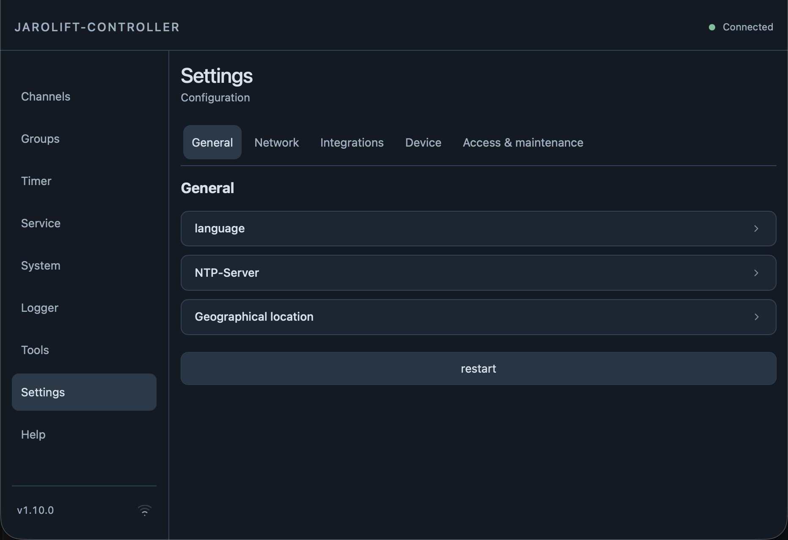

## Config Import and Export

Use **Tools → Configuration file** to view, export or import `config.json`. Restart the controller after importing a backup so the restored JAROLIFT settings take effect.

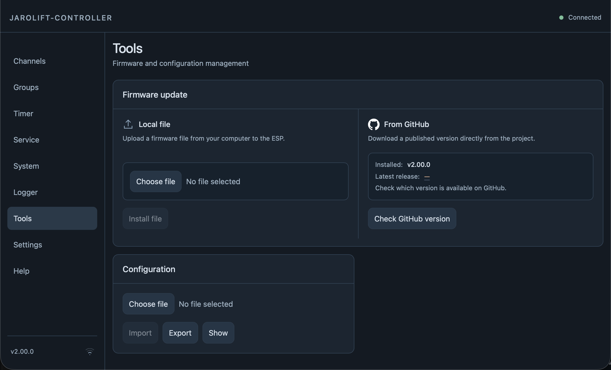

### Base serial migration

The base serial in the WebUI is the starting value for the radio serial the controller transmits. To form the 28-bit radio serial, the firmware shifts the six-digit hexadecimal base serial to the left and appends the channel index. Firmware v2.0.2 (`config.version=8`) reduces this internal shift from 8 to 4 bits. Four bits are enough for the 16 channel indices.

To compensate for the new shift, the firmware automatically converts the stored base serial once per configuration with `config.version<8`, both on update and when importing an older backup. For example, under **Settings → Device → JAROLIFT**, `012345` becomes `123450`. The first channel (index `0`) has the same radio serial `1234500` before and after the update.

The radio identity of all 16 channels is preserved for installations on v2.0.0 or v2.0.1 and for installations before v2.0.0 with a base serial of `0FFFFF` or less. Motors paired on these installations need no new teach-in.

If an installation predates v2.0.0 and used a base serial above `0FFFFF`, some motors may require a new teach-in because the old firmware could generate different keys or incorrect commands. The warning is based on the stored base serial alone, so it also appears when migrating a base serial above that limit from v2.0.0 or v2.0.1.

**Downgrade or OTA rollback.** If you return from v2.0.2 (`config.version=8`) to an older release, wait for the older firmware to start, restore the pre-update `config.json` and restart before operating the shutters. Keep the current transmitter device counter, which is stored separately in flash. For a planned downgrade, record the counter just before switching firmware and verify it after restoring the configuration.

## Teach-in of roller shutters

There are basically several ways to teach-in a roller shutter.
There are the same options as when using the original remote controls.

### Teach-in by pressing the teach-in button on the motor

Every TDEF motor has a button for programming new remote controls.
If you press this button, the motor confirms the learning process with a vibration.

> [!TIP]
> If you cannot reach the button, you can also switch the motor off for a few seconds. For example, by briefly switching off the fuse.

Now press the corresponding ‘Learn button’ in the WebUI in the settings for the respective roller shutter within 5 seconds.
If the roller shutter has been successfully programmed, the motor will vibrate again.

### Programming by copying an existing radio code

Alternatively, you can also use an already programmed remote control and ‘copy’ it.
To do this, press the UP and DOWN buttons simultaneously on the already programmed transmitter. Then, on this transmitter, press the STOP button
eight times on this transmitter. The motor will vibrate briefly to confirm.

Now press the corresponding ‘Learn button’ in the WebUI in the settings for the respective roller shutter within 5 seconds.
If the roller shutter has been successfully learnt, the motor will vibrate again.

## Migration

It is possible to migrate from a latest version of [madmartin/Jarolift_MQTT](https://github.com/madmartin/Jarolift_MQTT) to this project.

### Get a working Setup of this Project

- get a working version of this project up and running
- set the right GPIO settings for CC1101
- set the Master Keys
- set the Log-Level in the Logger of the WebUI to "Debug"

### Get the right serial number

- execute a shutter UP command of "old" Setup `(madmartin/Jarolift_MQTT)` for **channel 0!**.
- now you should see a debug message of this command in the Logger of the WebUI.  
It contains a message with `I (220364) JARO: received remote signal | serial: 0c7c00 | ch: 3 | cmd: 0x8, | rssi: -96 dbm` 
This **serial** number should be the same as configured in the WebUI of the "old" setup, but now we are sure to have the right one.
- set this serial in the WebUI of this project

### Get the right Device Counter

- read the actual device counter of the "old" setup from the System Page of the WebUI.
- set the same Device Counter value in the settings of this project.

### define the Shutter

- define the same shutter as in the "old" setup and activate them.

finished!  
now restart the ESP and test it.  
After restarting, first check whether the device counter has been read correctly from the EEPROM. Only continue testing if this is the case.
If everything done correct, all shutters should work like before. If not, some setting is wrong or you haven´t used the latest version of `(madmartin/Jarolift_MQTT)`. In that case I would prefer to set a new Serial number, reset the Device Counter und learn the shutter again.

-----

# WebUI

The WebUI is responsive and also offers a mobile layout.

(Desktop Version)


(Mobile Version)

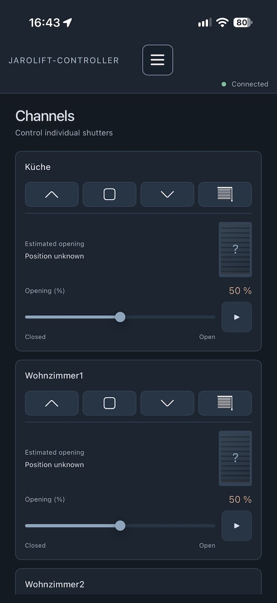
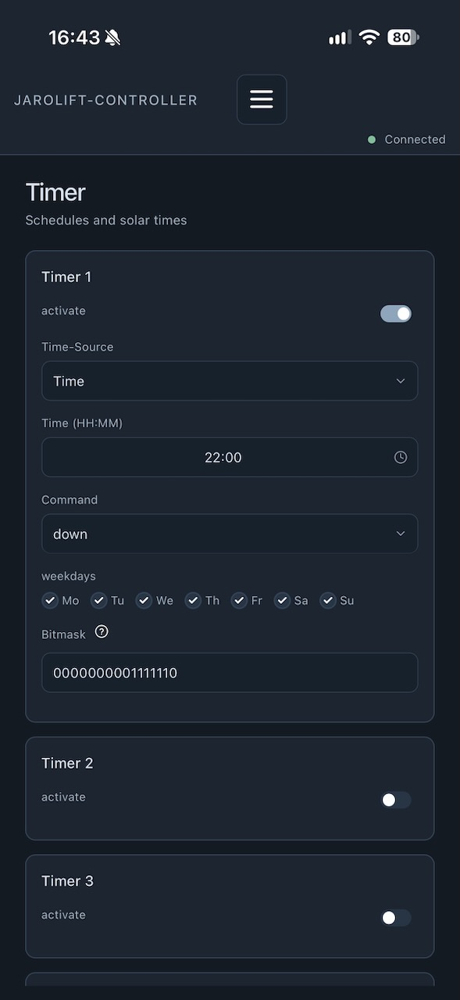
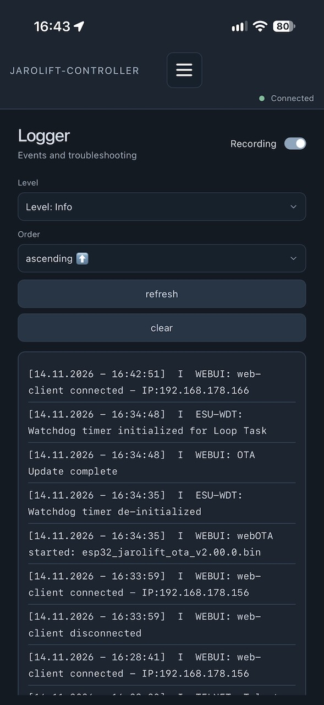

## Channels

Each enabled shutter has its own control with **UP, STOP, DOWN and SHADE**. These buttons remain available independently of percentage positioning.

With positioning disabled globally, the additional position section is hidden. With positioning enabled:

- **Not calibrated:** only a compact notice and a link to calibration appear below the normal buttons.
- **Calibrated:** a small shutter graphic and estimated opening are shown, together with a target slider and a separate execute button. Moving the slider selects a target; only pressing the execute button starts the movement.
- **Position unknown:** no measured position is implied. A percentage target can still be requested because it starts with a reference run.


## Groups

Configured groups offer the same UP/STOP/DOWN/SHADE commands for their selected shutters. Percentage targets for groups are not currently supported.

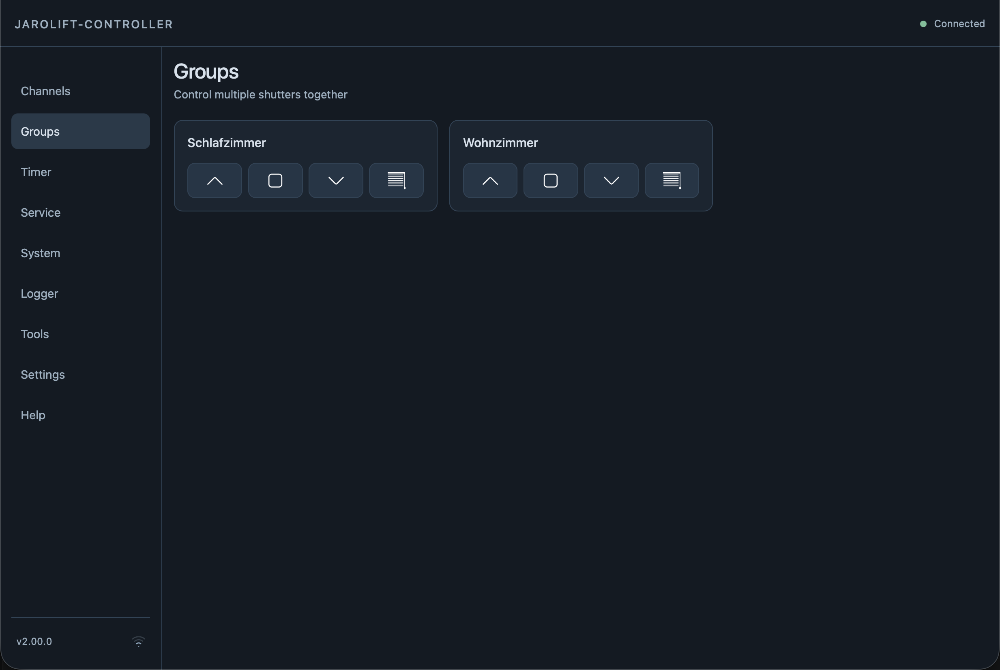

## Timer

Timers control an individual shutter or a group of shutters. Choose a fixed time, sunrise or sunset, optionally with an offset, plus weekdays and the command. Geographic coordinates are configured under **Settings → General**. The shutter-selection dialog creates the target bitmask automatically.

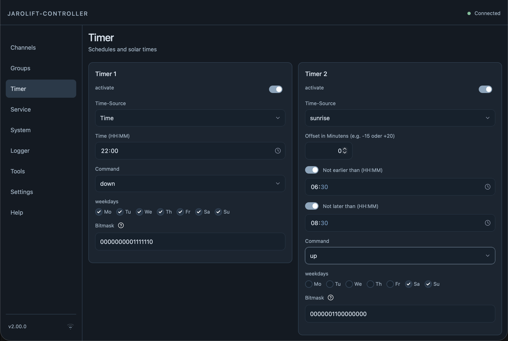


## Service

Select the shutter at the top of the Service page. The same selection is used for manual operation, setting/deleting motor end positions, setting the shade position, position calibration and original-remote associations.

Motor pairing is configured under **Settings → Device → Shutters**. Registering an original remote on Service only tells the ESP about an existing motor/remote relationship; it does not pair the remote with the motor.

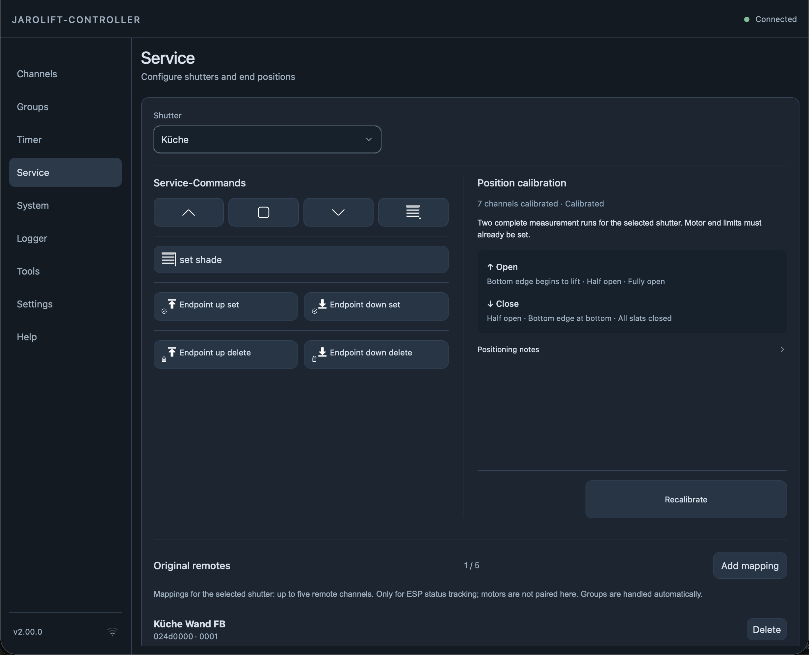

## Percentage positioning

### Principle and activation

The motors do not report their position or end stops. Positioning therefore uses **calibrated travel times**, not measured position feedback. The opening scale is **0% = fully closed, 100% = fully open**.

Enable the feature under **Settings → Device → Position control**. It is optional and applies globally; only individually calibrated shutters receive percentage controls. Other shutters remain usable with their normal buttons.

Every percentage request first travels to a known end position, regardless of the previously estimated position:

| Target opening | Movement |
| --- | --- |
| 0% | Fully close. |
| More than 0%, below 50% | Fully close, pause, then open to the requested percentage. |
| 50% to below 100% | Fully open, pause, then close to the requested percentage. |
| 100% | Fully open. |

The reference run uses the full calibrated travel time plus a reserve of 5%, at least one second and at most three seconds. The direction-change pause is 600 ms. This deliberately takes longer than a direct move, but avoids relying on a remembered starting position after unobserved remote operation.

### Calibrating a shutter

First configure the motor's actual end stops. Calibration does not replace them. Mark the halfway point of the opening height and keep the shutter in direct view.

1. On **Service**, select the enabled shutter and close it completely with the normal buttons.
2. Open calibration and confirm the fully closed starting position.
3. Start opening. Confirm when the shutter curtain first lifts, when it reaches half height, and when it is fully open.
4. From the fully open position, start closing. Confirm half height, arrival of the bottom edge at the bottom, and finally complete slat closure.
5. Review and explicitly apply the recorded times. Only this replaces existing calibration and stores it in `config.json`.

These landmarks account for the initial take-up/slat movement and approximate the changing winding diameter using separate opening and closing curves with linear interpolation between the marks. The values are elapsed times from the start of each direction, not individual segment durations. Each direction is limited to 180 seconds; implausible timings are rejected.

Keep the calibration page in the foreground. The browser sends a heartbeat; after more than six seconds without it, the ESP aborts calibration and sends STOP. This requires the ESP to remain operational and the radio command to reach the motor. A connection loss does not guarantee an immediate stop.

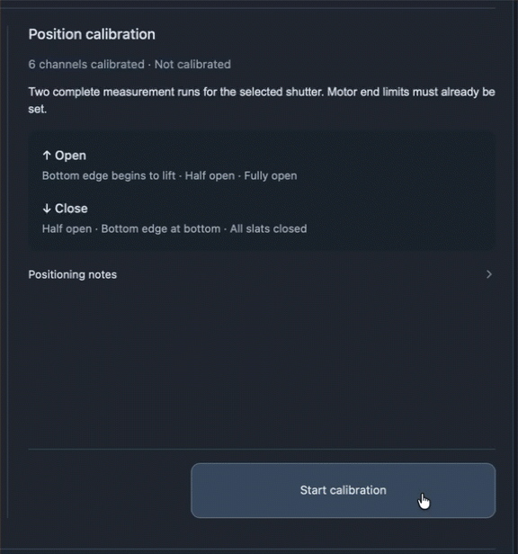

### Status, manual operation and limitations

Calibration survives a restart; the current position estimate does not. STOP, SHADE and a restart make the position unknown. With calibrated shutters, manual UP/DOWN assumes the end position only after the full travel time plus reserve. Received commands from assigned original remotes update the same estimate, even without MQTT. Signals that are not received cannot be accounted for.

Automatic target runs are processed sequentially. WebUI, MQTT and Home Assistant share a RAM queue for up to **16 waiting targets**, in addition to the active run. A new target replaces the waiting target for the same shutter without changing its queue position. The WebUI keeps other calibrated shutters usable and marks pending targets with a spinner in the execute button and a compact queued-target label; the queue position is available in the button tooltip. Calibration requires an idle controller and an empty queue. Manual commands have priority, cancel the automatic sequence and discard all waiting targets; there is no automatic restart. Once accepted, a normal percentage run is completed by the ESP even if the browser is closed. Motor learning/unlearning or end-position changes invalidate that shutter's calibration; disabling positioning or starting OTA aborts automatic movement sequences.

A reference run compensates for an unknown initial position. It cannot protect against an unreceived remote command during the run. Test 25%, 50% and 75% on each calibrated shutter before relying on the estimate.

Percentage targets are also available through [MQTT and Home Assistant](#percentage-targets--home-assistant). Further details: [Positionierung.md](Doc/Positionierung.md) (German).

## Original remote registration

### What is being assigned?

On **Service**, select a shutter and register the original remote's **single channel that is already paired with this motor**. This association lets the ESP update its position estimate and MQTT status when the original remote is used. It does not send a motor teach-in command and does not change actual motor pairing.

No remote model, serial number or bitmask needs to be entered manually. The source is captured from the received radio signal. A source channel can be assigned to several ESP shutters, and each shutter can have **up to five associations**. There are at most **80 distinct sources** overall. Names are limited to **32 Unicode characters**.

### Registering and removing an association

1. Select the intended shutter on **Service** and choose **Original remotes → Add mapping**.
2. Select the appropriate **single channel** on the original remote and press a button, preferably STOP. UP/DOWN can also be captured, but may move the actual motor.
3. Release the button, wait briefly and press the same channel again to confirm it. A long press with repeated telegrams is not the intended confirmation. The command may differ between the two presses; the source channel must match.
4. Name the source and save. It is assigned to the selected shutter. Repeat for other shutters controlled by that source; existing associations are retained.

The list shows only associations for the selected shutter. **Delete** removes only that relationship, leaving associations to other shutters and real motor pairing intact. Capturing an existing source again allows its shared name to be changed; that name is also used for its other assigned shutters.

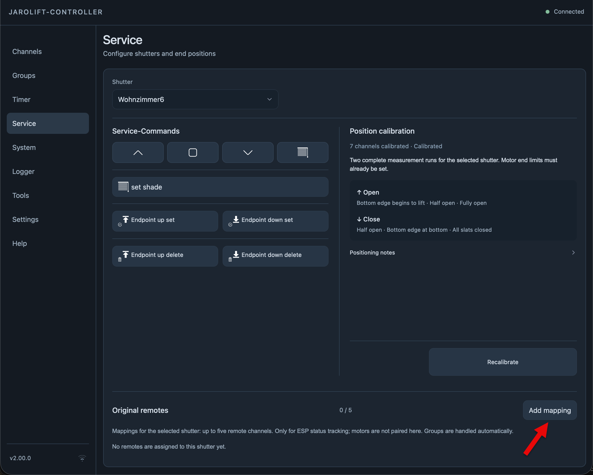 
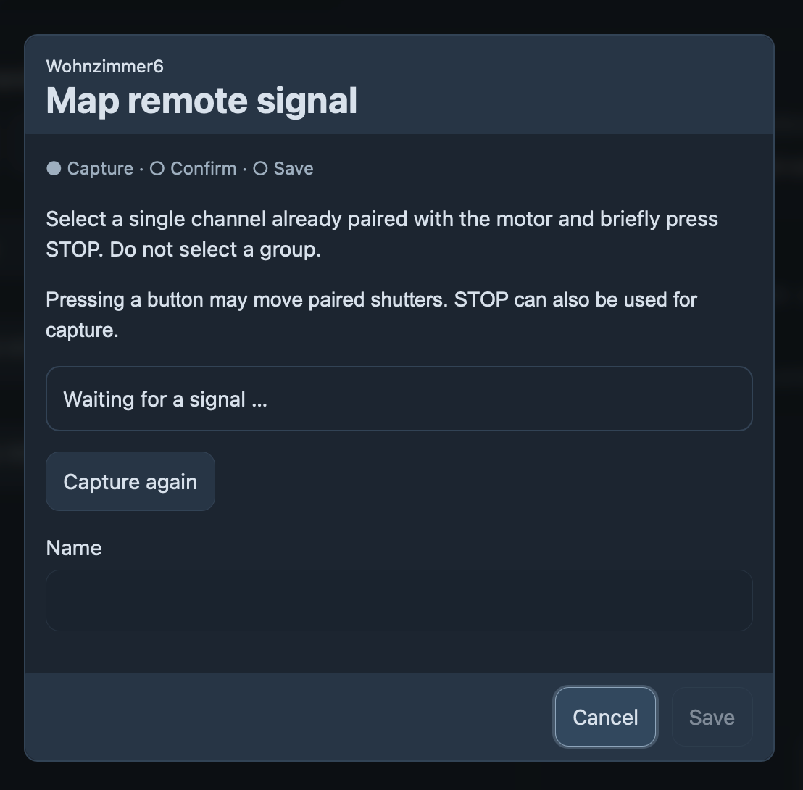 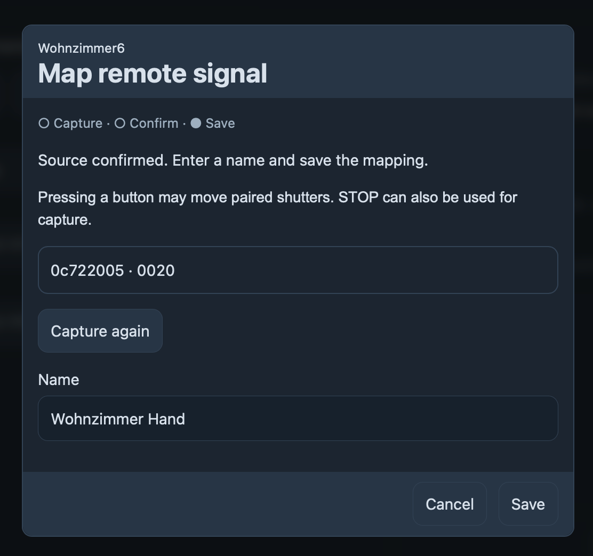

### Group buttons and existing configurations

Register individual source channels, not a group selection. Group commands are resolved automatically: the ESP matches the sender identity and the received channel bits against registered single-channel sources, then combines the affected ESP shutters. A group needs no additional entry. Source-channel numbers need not match the ESP shutter numbers.

For example, remote channel 1 can be assigned to ESP shutter 3 and remote channel 4 to ESP shutter 8. A group containing both remote channels updates shutters 3 and 8. Only registered relationships are considered; the ESP cannot infer which motors actually moved from an unregistered group.

Configuration version 7 migrates version-6 single-channel mappings and merges duplicate sources while preserving their targets. Old explicit group mappings are shown as requiring recapture and are not evaluated: capture their individual channels for the appropriate motors. Older serial-prefix-only registrations must also be captured again. Existing imported associations beyond the new five-per-shutter limit are retained, but must be reduced before adding more to that shutter.

Reliable reception is still required. Registration does not make corrupted or missed radio signals reliable. Measurement examples are documented in [remotes.md](Doc/remotes.md).


-----

# MQTT

## Commands

### Shutter

To control the shutters you can use the following mqtt commands.
{UP, OPEN, 0} means, that you can use one of the listed payload commands.

```text
command:    restart ESP
topic:      ../cmd/restart
payload:    none

command:    shutter up
topic:      ../cmd/shutter/1 ... cmd/shutter/16
payload:    {UP, OPEN, 0}

command:    shutter down
topic:      ../cmd/shutter/1 ... cmd/shutter/16
payload:    {DOWN, CLOSE, 1}

command:    shutter stop
topic:      ../cmd/shutter/1 ... cmd/shutter/16
payload:    {STOP, 2}

command:    shutter shade
topic:      ../cmd/shutter/1 ... cmd/shutter/16
payload:    {SHADE, 3}

```

### predefined Group

To control shutters a group you can use the following mqtt commands.
{UP, OPEN, 0} means, that you can use one of the listed payload commands.

```text

command:    group up
topic:      ../cmd/group/1 ... cmd/group/6
payload:    {UP, OPEN, 0}

command:    group down
topic:      ../cmd/group/1 ... cmd/group/6
payload:    {DOWN, CLOSE, 1}

command:    group stop
topic:      ../cmd/group/1 ... cmd/group/6
payload:    {STOP, 2}

command:    group shade
topic:      ../cmd/group/1 ... cmd/group/6
payload:    {SHADE, 3}

```

### Group with bitmask

You can also use a generic group command and provide the bitmask to select the shutters directly.  
The bitmask is a 16-bit number, with the least significant bit (on the right) representing channel 1.  
A set bit means that the channel belongs to this group.  

**Example**: `0000000000010101` means that channels 1, 3, and 5 belong to this group.

As payload, you can use three different formats to represent the same bitmask:

- **Binary**: `0b0000000000010101`
- **Hex**: `0x15`
- **Decimal**: `21`

```text

command:    group up
topic:      ../cmd/group/up
payload:    {0b0000000000010101, 0x15, 21}

command:    group down
topic:      ../cmd/group/down
payload:    {0b0000000000010101, 0x15, 21}

command:    group stop
topic:      ../cmd/group/stop
payload:    {0b0000000000010101, 0x15, 21}

command:    group shade
topic:      ../cmd/group/shade
payload:    {0b0000000000010101, 0x15, 21}

```

## Status

### shutter status

The controller will also send a status **based on the commands**.  

The status is an estimate without motor feedback. Calibrated shutters assume a manual UP/DOWN endpoint only after the full travel time plus reserve; uncalibrated shutters report the expected endpoint immediately. Received commands from assigned original remotes update the same estimate even while MQTT is offline. Missed signals remain undetectable. STOP/SHADE invalidate the estimate; `None` means unknown. MQTT reconnect republishes the current estimate. Command codes (0 = UP, 1 = DOWN) are unchanged, not percentage targets.

```text

Status:     Shutter OPEN
topic:      ../status/shutter/1 ... status/shutter/16
payload:    {100}

Status:     Shutter CLOSED
topic:      ../status/shutter/1 ... status/shutter/16
payload:    {0}

Status:     Shutter SHADE
topic:      ../status/shutter/1 ... status/shutter/16
payload:    {None}
```

> [!IMPORTANT]
> Breaking change: shutter status now uses 0 = closed and 100 = open, reversing the previous scale. Update automations that interpret the old status values. Command codes (0 = UP, 1 = DOWN) have not changed.

### Percentage targets / Home Assistant

With positioning enabled globally and valid channel calibration, `../cmd/position/1` through `/16` accept integer opening targets from 0 (closed) to 100 (open), without retain. The same reference sequence as the WebUI is used. Discovery automatically adds percentage control for eligible channels and removes it when disabled or uncalibrated. OPEN/CLOSE/STOP remain available; group percentage moves are not included.

### Remotes

Valid received remote commands are published while MQTT is connected under `../status/remote/<full-serial-number>`, for example `../status/remote/0c4b000f`. [Service associations](#original-remote-registration) supply the name and affected ESP shutters. Unassigned sources are reported with `name: "unknown"`; multiple matching sources can appear as `"multiple"`.

`chBin` and `chDec` describe the same **received source-channel mask** as a 16-bit binary string and a decimal value. They are not the target mask of the ESP shutters; the separately stored associations determine those targets.

Topic: `../status/remote/0c74b000f`

```json
{
  "name": "Living room · channel 16",
  "cmd": "UP",
  "chBin": "10000000 00000000",
  "chDec": 32768
}
```

`cmd` can be `UP`, `DOWN`, `STOP` or `SHADE`. In these examples, `../` is a placeholder for the configured MQTT prefix.

## additional information's (read only)

status information about WiFi:

```text
Topic: ESP32-Jarolift-Controller/wifi = {  
    "status":"online",  
    "rssi":"-50",  
    "signal":"90",  
    "ip":"192.168.1.1",  
    "date-time":"01.01.2022 - 10:20:30"  
}
```

## Home Assistant

MQTT discovery for Home Assistant makes it easy to get all values in Home Assistant.
The configured shutters will automatically visible as mqtt device in Home Assistant if HomeAssistant is enabled.

see also the official documentation: <https://www.home-assistant.io/integrations/mqtt/#discovery-messages>


Under **Settings → Integrations → Home Assistant**, enable discovery and configure the discovery topic and device name. MQTT must also be enabled and configured under **Integrations → MQTT**.

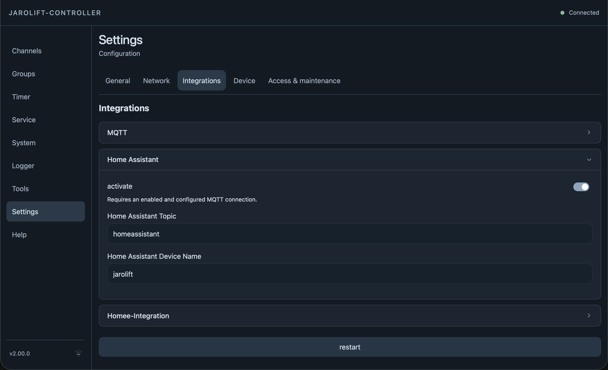

-----

# Optional Communication

in addition to mqtt there are more communication options.

## WebUI-Logger

There is also a log function with which you can record various messages depending on the filter and display them via the WebUI. This can be useful for your own debugging and also for the further development of the software.

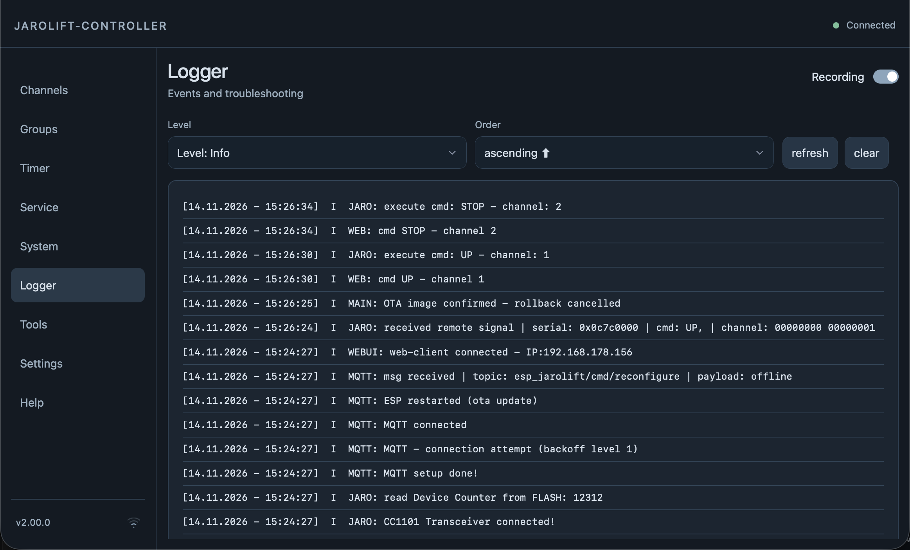

On ESP32-S2, the diagnostic log retains up to **128 entries** to fit its smaller internal data-RAM budget. Other supported ESP32 variants retain up to **200 entries**.

## Telnet

Telnet provides diagnostic and control commands; `help` lists the available commands. Under **Settings → Access & maintenance → Service access**, set a service password and explicitly enable Telnet. Without a service password, Telnet stays disabled in normal operation, independently of the WebUI password.

Connect with `telnet <ESP-IP-address>` and enter the service password at the password prompt. No username is required. An incorrect password disconnects the client; each new connection requires authentication again. Setup Mode follows the rules under [Access and passwords](#access-and-passwords).

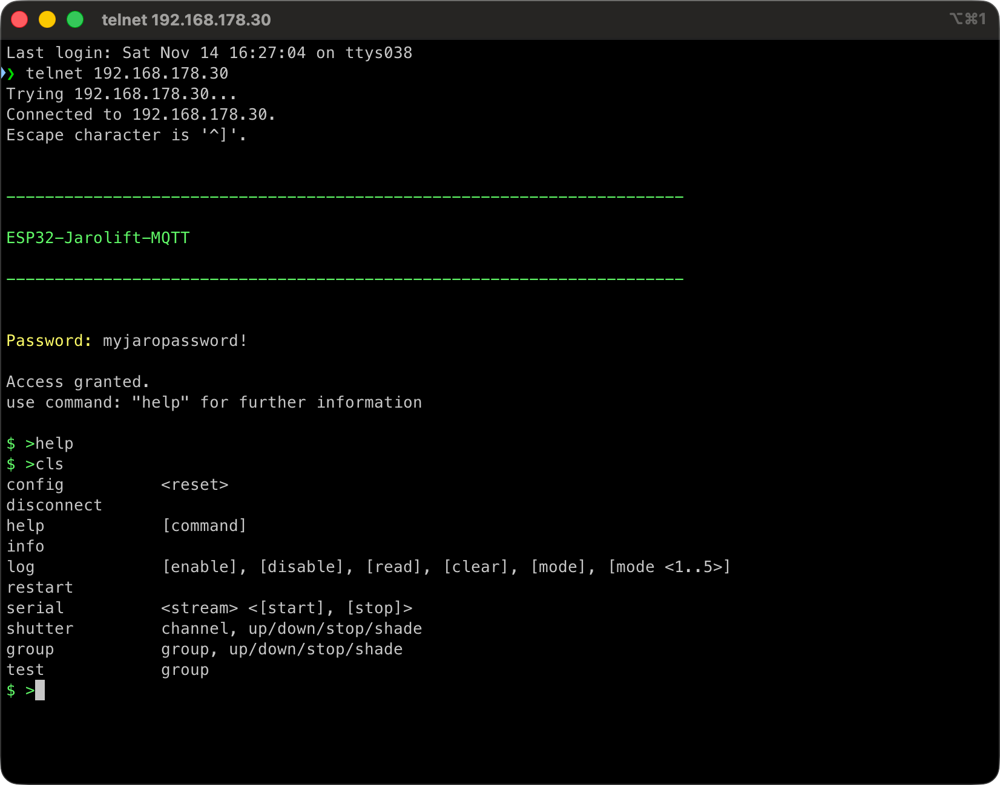
