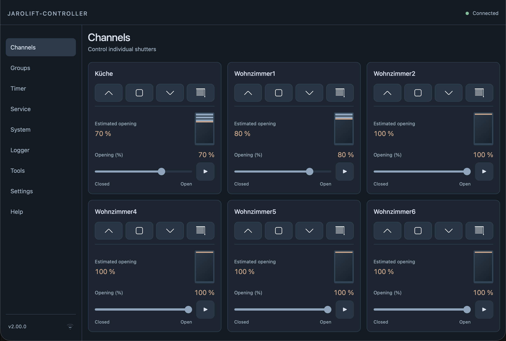
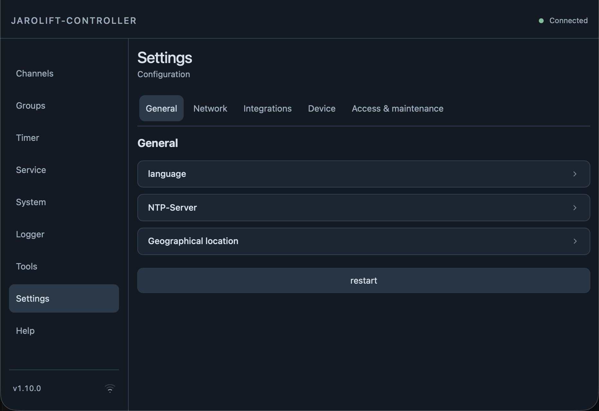
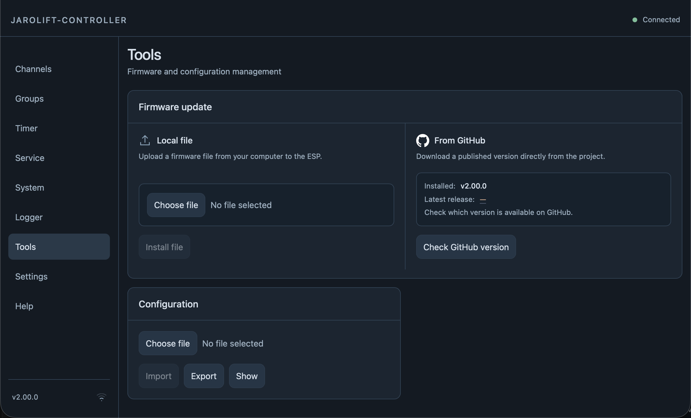
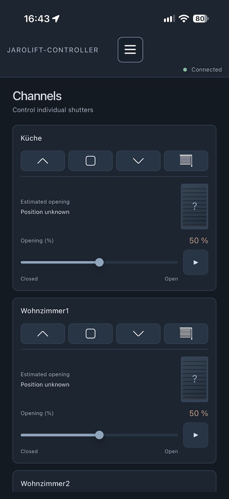
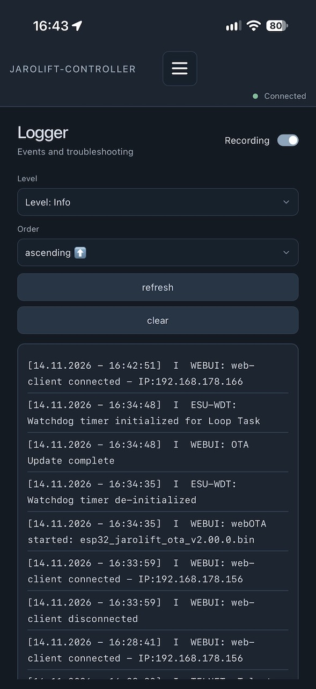
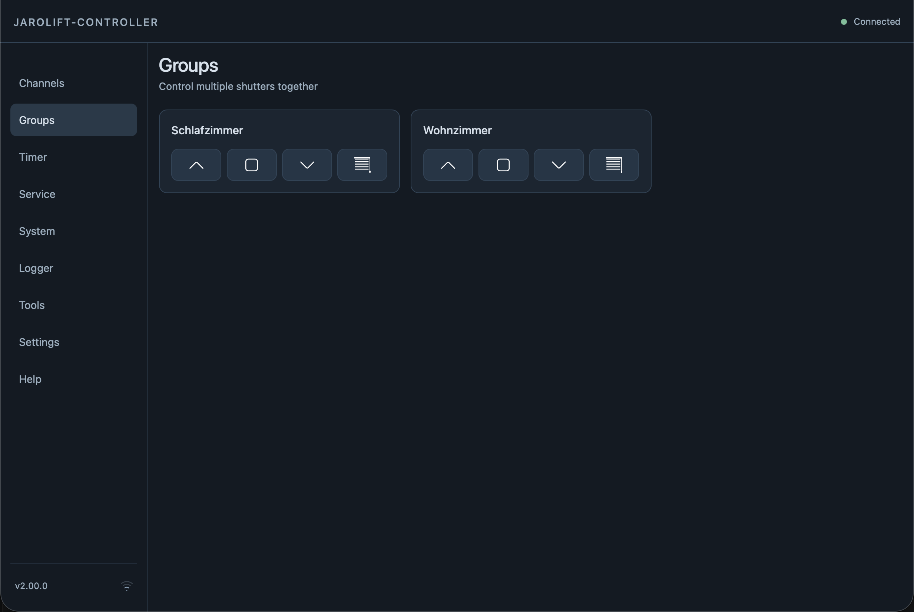
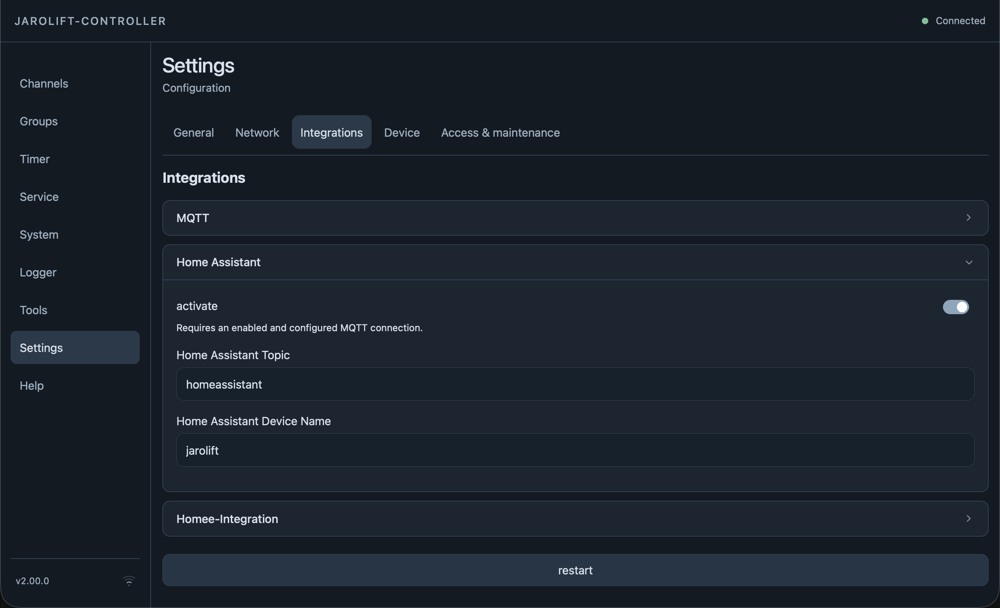

<div align="center">


<h3 style="text-align: center;">ESP32-Jarolift-Controller</h3>
</div>

-----

**[🇬🇧 English version](README.md)**

-----

<div align="center">

[](https://github.com/dewenni/ESP32-Jarolift-Controller/releases/latest)


[](https://github.com/dewenni/ESP32-Jarolift-Controller/stargazers/)

</div>

-----

<div align="center">
Wenn dir dieses Projekt gefällt, klicke gerne auf <b>[Star ⭐️]</b> und <b>[Watch 👁]</b> um auf dem Laufenden zu bleiben.
<br><br>
Und wenn du meine Arbeit unterstützen möchtest, kannst auch folgendes nutzen <p>

[](https://github.com/sponsors/dewenni)

</div>

-----

# ESP32-Jarolift-Controller

Steuerung von Jarolift(TM) TDEF 433MHz Funkrollläden über **ESP32** und **CC1101** Transceiver Modul im asynchronen Modus.




## Features

- **Webbasierte Benutzeroberfläche (WebUI):**  
Eine moderne, mobilfreundliche Schnittstelle für einfache Konfiguration und Steuerung.

- **MQTT-Unterstützung:**  
Die Kommunikation und Steuerung der Geräte erfolgt über MQTT, ein leichtgewichtiges und zuverlässiges Messaging-Protokoll.

- **HomeAssistant-Integration:**  
Automatische Geräteerkennung in HomeAssistant durch MQTT Auto Discovery für nahtlose Integration.

- **Unterstützung für bis zu 16 Rollläden:**  
Steuern von bis zu 16 Rollläden, die alle über die WebUI und MQTT verwaltet werden.

- **Unterstützung für bis zu 6 Rollladengruppen:**  
Definiere bis zu 6 Rollladengruppen, um mehrere Rollläden auf einmal zu steuern

- **Timer Funktion**  
für Stand-Alone Anwendung auch mit integrierter Timer Funktion mit fester Uhrzeit, Sonnenaufgang oder Sonnenuntergang als Auslöser.

- **Zeitbasierte Positionssteuerung:**
Optionale Prozentziele mit abschaltbarer Referenzfahrt und individueller Kalibrierung je Rollladen. WebUI, MQTT und Home Assistant verwenden dieselbe geschätzte Öffnung: 0 % geschlossen, 100 % geöffnet.

- **Originalfernbedienungen zuordnen:**
Einzelkanäle per Service-Dialog einem oder mehreren Rollläden zuordnen. Empfangene Einzel- und Gruppenbefehle werden für den gemeinsamen Status berücksichtigt.

### WebUI-Demo

Um sich einen ersten Eindruck von den Funktionen und der WebUI zu verschaffen, steht auch eine eingeschränkte Demo zur Verfügung.  
Diese kann über den folgenden Link aufgerufen werden: [WebUI-DEMO](https://dewenni.github.io/ESP32-Jarolift-Controller/)

Experimentelle Version.
Die Verwendung erfolgt auf eigene Gefahr. Nur für den privaten/schulischen Gebrauch. (Keeloq-Algorithmus ist nur für TI-Mikrocontroller lizenziert)
Dieses Projekt ist in keiner Weise mit dem Hersteller der Jarolift-Komponenten verbunden.
Jarolift ist ein Warenzeichen der Schöneberger Rolladenfabrik GmbH & Co. KG

Diese Version ist für einen ESP32 und basiert auf Ideen und Code von [madmartin/Jarolift_MQTT](https://github.com/madmartin/Jarolift_MQTT).

### Projekt-Homepage, Forum und Autor

Der ursprüngliche Steuercode wurde von Steffen Hille im Nov. 2017 geschrieben.

Die Homepage des Projekts ist hier: [Project Home](http://www.bastelbudenbuben.de/2017/04/25/protokollanalyse-von-jarolift-tdef-motoren/)

-----

# Inhaltsverzeichnis

- [Hardware](#hardware)
  - [ESP32](#esp32)
  - [CC1101 433Mhz](#cc1101-433mhz)
  - [Optional: Ethernet Modul W5500](#optional-ethernet-modul-w5500)
- [Erste Schritte](#erste-schritte)
  - [Platform-IO](#platform-io)
  - [ESP-Flash-Tool](#esp-flash-tool)
  - [OTA-Updates](#ota-updates)
  - [Setup-Mode](#setup-mode)
  - [Zugänge und Passwörter](#zugänge-und-passwörter)
  - [Konfiguration](#konfiguration)
  - [Konfiguration importieren und exportieren](#konfiguration-importieren-und-exportieren)
    - [Migration der Basisseriennummer](#migration-der-basisseriennummer)
  - [Anlernen von Rolläden](#anlernen-von-rolläden)
  - [Migration](#migration)
- [WebUI](#webui)
  - [Kanäle](#kanäle)
  - [Gruppen](#gruppen)
  - [Timer](#timer)
  - [Service](#service)
  - [Positionssteuerung](#positionssteuerung)
  - [Originalfernbedienungen zuordnen](#originalfernbedienungen-zuordnen)
- [MQTT](#mqtt)
  - [Kommandos](#kommandos)
  - [Status](#status)
  - [Home Assistant](#home-assistant)
- [Optionale Kommunikation](#optionale-kommunikation)
  - [WebUI-Logger](#webui-logger)
  - [Telnet](#telnet)

-----

# Hardware

Du findest funktionierende Setups von Benutzern dieses Projekts hier: [funktionierende Setups](https://github.com/dewenni/ESP32-Jarolift-Controller/discussions/34)

## ESP32

Die Firmware ist aktuell nur für folgende Chips erstellt

**Standard ESP32 (Xtensa® 32-bit LX6, 4MB Flash)**

- `ESP32-WROOM-32 Serie` (z.B. WROOM, WROOM-32D, WROOM-32U)
- `ESP32-WROVER Serie` (z. B. WROVER, WROVER-B, WROVER-IE)
- `ESP32-MINI Serie`
- `ESP32-S2 series`
- `ESP32-S3 series`
- `ESP32-C3 series`

**nicht Kompatibel:**

- `ESP32-H series`
- `YB-ESP32-S3-ETH`
- `WT32-ETH01`

## CC1101 433Mhz

**kompatible und getestete Produkte:**

- `EBYTE E07-M1101D-SMA V2.0`
- `CC1101 433MHZ Green`

eine Standard-SPI-GPIO-Konfiguration für den CC1101 und den ESP32 ist folgende:

| CC1101-Signal| ESP-GPIO|
|--------------|---------|
| VCC          | --      |
| GND          | --      |
| GD0          | 21      |
| GD2          | 22      |
| SCK/CLK      | 18      |
| MOSI         | 23      |
| MISO         | 19      |
| CS(N)        | 5       |


 


Beispiel mit ESP32-Mini und CC1101


Beispiel für direkten Austausch mit ESP32-Mini und dem Custom Board von M. Maywald (vermutlich nicht mehr verfügbar)

## Optional: Ethernet Modul W5500

Es ist auch möglich, ein W5500 Ethernet-Modul an das Board oder einen generischen ESP32 anzuschließen.

**kompatible und getestete Produkte:**

- `W5500` HanRun (HR911105A)
- `W5500 Lite` HanRun (HR961160C)

> [!IMPORTANT]
> Das Anschlusskabel sollte so kurz wie möglich sein (ca. 10 cm).

Beispiel für einen generischen ESP32-Mini (Standard SPI Port wird vom CC1101 verwendet)

| Signal| GPIO |
|-------|------|
| CLK   | 25   |
| MOSI  | 26   |
| MISO  | 27   |
| CS    | 32   |
| INT   | 33   |
| RST   | 17   |

-----

# Erste Schritte

## Platform-IO

Die Software wurde mit [Visual Studio Code](https://code.visualstudio.com) und dem [pioarduino-Plugin](https://github.com/pioarduino/pioarduino-vscode-ide) erstellt.  
Nach der Installation der Software kannst du das Projekt von GitHub klonen oder als zip herunterladen und in PlatformIO öffnen.
Dann noch den `upload_port` und die entsprechenden Einstellungen in `platformio.ini` an deinen USB-zu-Seriell-Adapter anpassen den Code auf den ESP hochladen.

> [!NOTE]
> Python muss ebenfalls installiert sein, um das Projekt vollständig zu kompilieren. Der Ordner scripts enthält beispielsweise Skripte für die Erstellung der Webseiten, die beim Kompilieren des Projekts aufgerufen werden.

## ESP-Flash-Tool

In den Veröffentlichungen (Releases) befinden sich auch die Binärdatei der Software. Wenn du PlatformIO nicht verwenden willst, kannst du auch die Datei `esp32_jarolift_controller_flash_vx.x.x.bin` verwenden und direkt auf den ESP flashen. Diese bin-Datei ist bereits ein Fertig mit bootloader.bin, partitions.bin und der application.bin. Du kannst dieses Image auf den ESP an Adresse 0x00 flashen.  

**Windows**  
Es gibt verschiedene Tools, um Binärdateien auf den ESP zu übertragen.  
Eines davon ist [espressif-flash-download-tool](https://www.espressif.com/en/support/download/other-tools)

**macOS/Linux**  
Für Mac ist es schwierig, ein Tool mit einer grafischen Benutzeroberfläche zu finden, aber es kann einfach das esptool.py verwendet werden:

1. Terminal öffnen
2. esptool installieren: `pip install esptool`  
3. optional den Installationspfad abfragen: `welches esptool.py`  
4. Pfad setzen: `export PATH=„$PATH:/<Pfad>/esptool.py“` (<- ändere <Pfad> mit Ergebnis aus 3.)
5. Gehe zu dem Pfad, in dem sich die bin-Datei befindet
6. Device String abfragen: `ls /dev/tty* | grep usb` (verwende dies im nächsten Schritt für <UPLOAD-PORT>)
7. Upload: `esptool.py -p <UPLOAD-PORT> write_flash 0x00 esp32_jarolift_controller_flash_vx.x.x.bin`  

## OTA-Updates

### lokales Web OTA-Update

Unter **Tools → Firmware-Update → Lokale Datei** die OTA-Datei für die verwendete ESP-Variante auswählen und **Datei installieren** anklicken. Beim ESP32 heißt die Release-Datei `esp32_jarolift_ota_vX.Y.Z.bin`; andere Chipvarianten haben einen eigenen Präfix. Für OTA die OTA-Datei verwenden, nicht das vollständige `*_flash_*`-Image zur Erstinstallation. Fortschritt und Ergebnis erscheinen auf der Tools-Seite.


### GitHub OTA-Update

Unter **Tools → Firmware-Update → Von GitHub** auf **GitHub-Version prüfen** klicken. Installierte Version, letztes veröffentlichtes Release und die Verfügbarkeit einer passenden OTA-Datei werden direkt auf dieser Seite angezeigt. Ist ein installierbares Release vorhanden, erscheint ein eigener Installationsbutton. Die Prüfung allein startet kein Update. Ältere Versionen werden ausdrücklich als Downgrade gekennzeichnet und müssen bestätigt werden.

Der Versionslink unten in der Navigation führt zu diesem Bereich. Das Update findet nicht mehr in einem Versions-Popup statt.


### PlatformIO OTA-Update

Drahtlose Uploads über ArduinoOTA verwenden das **Service-Passwort**, unabhängig von der WebUI-Authentifizierung. Dieses wird unter **Einstellungen → Zugriff & Wartung → Service-Zugänge** gesetzt. Ein leeres Service-Passwort deaktiviert ArduinoOTA im Normalbetrieb; es gibt dort kein Ersatzpasswort.

In `platformio.ini` die passende Umgebung verwenden und folgende Werte setzen:

```ini
upload_protocol = espota
upload_port = <IP-Adresse-des-ESP>
upload_flags = --auth=<Service-Passwort>
```

ArduinoOTA benötigt keinen Benutzernamen. Im Setup-Mode gilt das feste Passwort aus [Zugänge und Passwörter](#zugänge-und-passwörter).

Unterbrochene Browser-Uploads werden nach 60 Sekunden ohne Fortschritt abgebrochen. Dabei wird der vorherige Watchdog-Zustand wiederhergestellt. Der Controller bestätigt neue OTA-Firmware nach 30 Sekunden Laufzeit, auch ohne Netzwerkverbindung. Ein Neustart vor dieser Bestätigung kann einen Bootloader-Rollback zur vorherigen Firmware auslösen.

Vor dem Update auf v2.0.2 (`config.version=8`) die `config.json` exportieren. Die Sicherung für ein Downgrade oder einen OTA-Rollback aufbewahren. Siehe [Migration der Basisseriennummer](#migration-der-basisseriennummer).

## Setup Mode

Der Setup-Mode dient der Erstkonfiguration und Wiederherstellung. Er wird aktiviert, wenn WLAN ohne SSID eingeschaltet ist, beide Netzwerkschnittstellen ausgeschaltet sind oder bei aktivierter WebUI-Authentifizierung Benutzername beziehungsweise Passwort fehlen. Auch eine fehlende oder nicht lesbare Konfiguration führt in die Wiederherstellung. Alternativ den ESP **fünfmal neu starten**; jeder weitere Neustart muss innerhalb von fünf Sekunden nach dem vorherigen Start erfolgen.

Der ESP erstellt den WLAN-Accesspoint **`ESP32-Jarolift`**. Mit diesem verbinden und **<http://192.168.4.1>** öffnen. Der Accesspoint selbst hat kein WLAN-Passwort; für die WebUI gilt **`admin` / `jarolift-2026!`**. Diese festen Setup-Zugangsdaten funktionieren auch bei leerer oder beschädigter `config.json`. Die Zugangsdaten für den Normalbetrieb ersetzen sie nicht.

Anschließend das Netzwerk konfigurieren, die Einstellungen speichern und für den Normalbetrieb neu starten.

## Zugänge und Passwörter

WebUI-Zugang und Service-Zugang werden getrennt unter **Einstellungen → Zugriff & Wartung** eingerichtet:

| Zugang | Normalbetrieb | Setup-Mode |
| --- | --- | --- |
| WebUI | Optionale Authentifizierung: frei wählbarer Benutzername und Passwort sowie ein Schalter zum Aktivieren. Bei ausgeschalteter Authentifizierung ist keine Anmeldung erforderlich. | Anmeldung immer erforderlich: Benutzer `admin`, Passwort `jarolift-2026!`, unabhängig von der Konfiguration. |
| Lokales/GitHub-Update über die WebUI, Konfiguration importieren/exportieren | Folgt der WebUI-Authentifizierung; kein zusätzliches Service-Passwort. | Verwendet die WebUI-Anmeldung des Setup-Mode. |
| Remote-OTA über ArduinoOTA | Benötigt das separat konfigurierte Service-Passwort. Bei leerem Passwort deaktiviert. Kein Benutzername. | Festes Passwort `jarolift-2026!`; kein Benutzername. |
| Telnet | Muss separat eingeschaltet werden und benötigt das Service-Passwort. Bei leerem Passwort deaktiviert. Kein Benutzername. | Der Telnet-Schalter gilt weiterhin; bei aktiviertem Telnet gilt `jarolift-2026!`. Der Setup-Mode schaltet Telnet nicht automatisch ein. |

Das WebUI-Passwort und das Service-Passwort sind unabhängig. Eine ausgeschaltete WebUI-Authentifizierung hebt den Passwortschutz der Service-Zugänge nicht auf. Telnet und ArduinoOTA verwenden dasselbe Service-Passwort.

## Konfiguration

Die Einstellungen sind in fünf Kategorien gegliedert. Innerhalb einer Kategorie lässt sich der gewünschte Abschnitt aufklappen.

| Kategorie | Abschnitte und Verwendung |
| --- | --- |
| **Allgemein** | Sprache, NTP-Server/Zeitzone und geografische Lage. Breiten- und Längengrad werden für Timer mit Sonnenaufgang/Sonnenuntergang benötigt. |
| **Netzwerk** | WLAN-Zugangsdaten, optional fester Accesspoint (BSSID), IP-Konfiguration und Ethernet/W5500 einschließlich der SPI-GPIOs. |
| **Integrationen** | MQTT-Broker/Topic/Zugangsdaten, Home-Assistant-Discovery und homee. Home-Assistant-Discovery setzt eingerichtetes und aktiviertes MQTT voraus. |
| **Gerät** | Globaler Schalter für die Positionssteuerung, JAROLIFT-Protokolleinstellungen, Rollläden, Gruppen und GPIO-Zuweisung. Hier werden unter anderem Controller-Seriennummer/Masterkeys, Gerätezähler und Anlernmethode eingestellt, Rollläden aktiviert und benannt, Motoren angelernt sowie Gruppen definiert. |
| **Zugriff & Wartung** | Optionale WebUI-Authentifizierung und das separate Service-Passwort mit dem Telnet-Schalter. Siehe [Zugänge und Passwörter](#zugänge-und-passwörter). |

Für WLAN gibt es getrennte Suchbuttons für **SSID** und **Accesspoint/BSSID**. Ein gefundenes Netz beziehungsweise einen Accesspoint im Dialog auswählen; versteckte SSIDs lassen sich weiterhin manuell eingeben. Eine leere BSSID erlaubt die automatische Accesspoint-Auswahl. Mit fester BSSID wird nur dieser Accesspoint verwendet. Bei Änderung der SSID wird die bisherige BSSID zurückgesetzt.

Die Positionssteuerung wird unter **Gerät** zentral aktiviert. Jeder Rollladen wird anschließend separat auf der **Service-Seite** kalibriert. Auch Originalfernbedienungen werden dort beim ausgewählten Rollladen zugeordnet; eine manuelle Seriennummern-Eingabe in den Einstellungen entfällt.

Änderungen werden automatisch gespeichert. **Änderungen an GPIOs und JAROLIFT-Protokolleinstellungen benötigen einen Neustart.** Für Oberfläche und sprachabhängige Meldungen stehen Deutsch und Englisch zur Verfügung.



## Konfiguration importieren und exportieren

Unter **Tools → Konfiguration** lässt sich `config.json` anzeigen, exportieren und importieren. Der Name der ausgewählten Importdatei ist beliebig; übernommen wird sie immer als `config.json`. Vor dem Ersetzen wird gültiges JSON mit dem projektspezifischen Abschnitt geprüft. Nach erfolgreichem Import oder Wiederherstellen startet das Gerät automatisch neu.

**Backup auf dem Gerät** kopiert die bereits gespeicherte Konfiguration nach `config_backup.json`. Das Wiederherstellen ersetzt die aktuelle Konfiguration; das Backup bleibt erhalten. Beide Dateien zeigen ihren letzten Speicherzeitpunkt, bei fehlender gültiger Gerätezeit „Zeitpunkt unbekannt“. Schreib- oder Platzfehler lassen die bisherige Zieldatei bestehen.

Mit **Backup exportieren** lässt sich der gesicherte Stand direkt als `config_backup.json` herunterladen, ohne ihn vorher wiederherzustellen.

Das lokale Backup liegt auf demselben Flash und ersetzt keinen Export auf den Computer. Es enthält Zugangsdaten und sichert ausschließlich die Konfiguration, keine separat gespeicherten Zähler oder Verlaufsdaten. Exportierte Dateien vertraulich behandeln und nicht unbereinigt veröffentlichen.



### Migration der Basisseriennummer

Die Basisseriennummer in der WebUI ist der Ausgangswert für die tatsächlich gesendete Funkseriennummer. Für die 28-Bit-Funkseriennummer verschiebt die Firmware die sechsstellige hexadezimale Basisseriennummer nach links und fügt den Kanalindex an. Mit Firmware v2.0.2 (`config.version=8`) ändert sich diese interne Verschiebung von 8 auf 4 Bit. Vier Bit reichen für die Indizes der 16 Kanäle.

Zum Ausgleich rechnet die Firmware die gespeicherte Basisseriennummer einmal pro Konfiguration mit `config.version<8` automatisch um, sowohl beim Update als auch beim Import einer älteren Sicherung. Unter **Einstellungen → Gerät → JAROLIFT** wird zum Beispiel aus `012345` der Wert `123450`. Für den ersten Kanal (Index `0`) ergibt sich vor und nach dem Update dieselbe Funkseriennummer `1234500`.

Bei Installationen mit v2.0.0 oder v2.0.1 sowie bei Installationen vor v2.0.0 mit einer Basisseriennummer bis `0FFFFF` bleibt die Funkidentität aller 16 Kanäle erhalten. Bereits angelernte Motoren müssen in diesen Fällen nicht erneut angelernt werden.

Bei Installationen vor v2.0.0 mit einer Basisseriennummer über `0FFFFF` kann erneutes Anlernen erforderlich sein, weil die alte Firmware abweichende Schlüssel oder falsche Befehle erzeugen konnte. Die Warnung richtet sich allein nach der gespeicherten Basisseriennummer und erscheint deshalb bei der Migration einer Basisseriennummer über dieser Grenze auch für Installationen mit v2.0.0 oder v2.0.1.

**Downgrade oder OTA-Rollback.** Bei einer Rückkehr von v2.0.2 (`config.version=8`) auf eine ältere Firmware zuerst die ältere Firmware starten lassen. Dann die vor dem Update gesicherte `config.json` wiederherstellen und den Controller vor der nächsten Rollladenbedienung neu starten. Den aktuellen Gerätezähler des Senders beibehalten. Er liegt separat im Flash. Bei einem geplanten Downgrade den Zählerstand unmittelbar vor dem Firmwarewechsel notieren und nach dem Wiederherstellen der Konfiguration prüfen.

## Anlernen von Rolläden

Es gibt grundsätzlich mehrere Möglichkeiten um einen Rolladen anzulernen.
Es existieren die gleichen Möglichkeiten wie bei der Nutzung der original Fernbedienungen.

### Anlernen durch drücken der Anlerntaste am Motor

Jeder TDEF Motor hat eine Taste zum anlernen von neuen Fernbedienungen.
Drückt man diese Taste, bestätgt der Motor den Anlernvorgang mit einem vibrieren.

> [!TIP]
> Wenn man an die Taste nicht ran kommt, kann man den Motor auch für ein paar Sekunden Stromlos schalten. Z.B. in dem man die Sicherung kurz raus macht.

Jetzt innerhalb von 5 Sekunden den entsprechenden "Lern-Button" im WebUI in den Settings bei dem jeweiligen Rolladen drücken.
Wenn der Rolladen erfolgreich eingelernt wurde, vibriert der Motor erneut.

### Anlernen durch Kopieren eines bestehenden Funkcodes

Alternativ kann man auch eine bereits eingelernte Fernbedienung nutzen und diese "Kopieren".
Dazu auf dem bereits eingelernten Sender die AUF- und AB-Taste gleichzeitig. Danach, auf diesem Sender, die STOP-Taste
acht mal drücken. Der Motor wird zur Bestätigung kurz vibrieren.

Jetzt innerhalb von 5 Sekunden den entsprechenden "Lern-Button" im WebUI in den Settings bei dem jeweiligen Rolladen drücken.
Wenn der Rolladen erfolgreich eingelernt wurde, vibriert der Motor erneut.

## Migration

Diese Anleitung gilt für ESP32-Firmware ab v2.0.2. Um die angelernten Motoren weiterzuverwenden, die Sendereinstellungen von [madmartin/Jarolift_MQTT](https://github.com/madmartin/Jarolift_MQTT) übernehmen.

### Ein funktionierendes Setup für dieses Projekt herstellen

Bei einem OTA-Update einer bestehenden ESP32-Installation vor dem Neustart die Firmwarebestätigung abwarten. Siehe [OTA-Updates](#ota-updates).

Den ESP32 mit den zur CC1101-Verdrahtung passenden GPIO-Einstellungen einrichten und nach GPIO-Änderungen neu starten. Unter **Einstellungen → Gerät → JAROLIFT** die Masterkeys des alten Controllers eintragen.

### Die richtige Seriennummer ermitteln

Nach dem Update die auf dem **alten Jarolift_MQTT-Controller** eingestellte Basisseriennummer am ESP32 unter **Einstellungen → Gerät → JAROLIFT** manuell eintragen. Bis zu sechs Hex-Ziffern ohne `0x` verwenden, zum Beispiel `12DEAF`. Die automatische Umrechnung beim Update erhält die zuvor vom ESP32 verwendeten Funkseriennummern. Die Übernahme der Jarolift_MQTT-Funkidentität erfordert diesen manuellen Schritt. Siehe [Migration der Basisseriennummer](#migration-der-basisseriennummer).

Falls sich die alte Basisseriennummer nicht ablesen lässt, am alten Controller einen einzelnen AUF-Befehl für **Kanal 0** auslösen und die vollständige Funkseriennummer im Logbuch des ESP32 ablesen. `0x` und die letzte Hex-Ziffer entfernen (bei Kanal 0 die `0`). Dann die führenden Nullen so anpassen, dass sechs Hex-Ziffern übrig bleiben. Bei der empfangenen Seriennummer `0x012DEAF0` lautet die einzutragende Basisseriennummer `12DEAF`.

### Den richtigen Gerätezähler finden

Nach dem letzten Befehl des alten Controllers dessen aktuellen Gerätezähler auf der **System**-Seite seiner WebUI ablesen. Anschließend den alten Controller ausschalten, damit nur der ESP32 mit dieser Funkidentität sendet. Den abgelesenen Wert unverändert unter **Einstellungen → Gerät → JAROLIFT → Device Counter** eintragen.

### Die Rollläden definieren

Die Rollläden in derselben Kanalreihenfolge einrichten und aktivieren. Der alte Kanal `0` entspricht Kanal `1` in der ESP32-WebUI, der alte Kanal `15` entspricht Kanal `16`.

Den ESP32 neu starten und im Logbuch prüfen, ob der übernommene Gerätezähler aus dem Flash geladen wurde. Dann einen bereits angelernten Rollladen mit einem Einzelbefehl testen. Falls er nicht reagiert, die Funkseriennummer für diesen Kanal, die Masterkeys und den übernommenen Zähler prüfen.

-----

# WebUI

Die WebUI passt sich der Fenstergröße an und bietet auch eine mobile Darstellung.

(Desktop-Version)


(Mobile Version)





## Kanäle

Jeder aktivierte Rollladen besitzt eine eigene Bedienung mit **AUF, STOP, AB und SCHATTEN**. Diese Tasten bleiben unabhängig von der Prozentsteuerung verfügbar.

Bei global ausgeschalteter Positionssteuerung wird kein zusätzlicher Positionsbereich eingeblendet. Bei aktivierter Funktion gilt:

- **Nicht kalibriert:** Unter den normalen Tasten erscheinen nur ein kompakter Hinweis und der Link zur Kalibrierung.
- **Kalibriert:** Eine kleine Rollladengrafik und die geschätzte Öffnung werden angezeigt, dazu Zielslider und separater Ausführen-Button. Verschieben des Sliders wählt nur den Sollwert; erst der Button startet die Fahrt.
- **Position unbekannt:** Es wird keine gemessene Position vorgetäuscht. Mit Referenzfahrt kann trotzdem ein Prozentziel angefahren werden. Ohne Referenzfahrt zuerst eine vollständige AUF-/AB-Fahrt abwarten.


## Gruppen

Konfigurierte Gruppen bieten dieselben Befehle AUF/STOP/AB/SCHATTEN für ihre ausgewählten Rollläden. Prozentziele für Gruppen werden derzeit nicht unterstützt.



## Timer

Timer steuern einzelne Rollläden oder eine Auswahl als Gruppe. Als Auslöser stehen eine feste Uhrzeit, Sonnenaufgang und Sonnenuntergang mit optionalem Zeitversatz zur Verfügung. Dazu werden Wochentage und Befehl eingestellt. Die geografische Lage wird unter **Einstellungen → Allgemein** hinterlegt. Der Rollladenauswahldialog erzeugt die Ziel-Bitmaske automatisch.


## Service

Oben auf der Service-Seite wird der Rollladen ausgewählt. Dieselbe Auswahl gilt für die manuelle Bedienung, das Setzen/Löschen der Motor-Endlagen, das Setzen der Schattenposition, die Positionskalibrierung und die Zuordnung von Originalfernbedienungen.

Das eigentliche Anlernen des Motors erfolgt unter **Einstellungen → Gerät → Rollläden**. Die Fernbedienungsregistrierung auf der Service-Seite informiert nur den ESP über eine bestehende Beziehung; sie lernt die Fernbedienung nicht am Motor an.


## Positionssteuerung

### Prinzip und Aktivierung

Die Motoren melden weder Position noch Endlage zurück. Die Positionssteuerung arbeitet deshalb mit **kalibrierten Fahrzeiten**, nicht mit einer gemessenen Positionsrückmeldung. Die Öffnungsskala lautet **0 % = vollständig geschlossen, 100 % = vollständig geöffnet**.

Unter **Einstellungen → Gerät → Positionssteuerung** wird die optionale Funktion global aktiviert. Prozentcontrols erscheinen nur bei individuell kalibrierten Rollläden. Andere Rollläden bleiben über die normalen Tasten bedienbar.

Standardmäßig fährt jede Prozentanforderung zuerst eine bekannte Endlage an, unabhängig von der zuvor geschätzten Position:

| Zielöffnung | Ablauf |
| --- | --- |
| 0 % | Vollständig schließen. |
| Größer 0 %, unter 50 % | Vollständig schließen, pausieren und dann bis zum Ziel öffnen. |
| Ab 50 %, unter 100 % | Vollständig öffnen, pausieren und dann bis zum Ziel schließen. |
| 100 % | Vollständig öffnen. |

Die Referenzfahrt verwendet die vollständige kalibrierte Fahrzeit mit 5 % Reserve, mindestens einer und höchstens drei Sekunden. Vor dem Richtungswechsel liegt eine Pause von 600 ms. Das dauert bewusst länger als eine direkte Fahrt, vermeidet aber die Abhängigkeit von einem gemerkten Ausgangswert nach unbemerkter Fernbedienungsbetätigung.

Unter **Einstellungen → Gerät → Positionssteuerung → Referenzfahrt vor Positionsvorgabe** kann die Referenzfahrt ausgeschaltet werden, wenn ausschließlich der ESP die Rollläden bedient. Zwischenziele werden dann direkt aus einer bekannten Schätzposition berechnet. Nach Neustart, STOP, SCHATTEN oder Abbruch zuerst vollständig AUF oder AB fahren lassen; bis dahin werden Zwischenziele abgewiesen. 0/100 % bleiben möglich. Der Befehlspuffer für Zwischenziele bleibt aktiv, um die STOP-Zeitpunkte zu schützen.

### Einen Rollladen kalibrieren

Zuerst die tatsächlichen Endlagen des Motors einrichten. Die Positionskalibrierung ersetzt diese nicht. Die halbe Öffnungshöhe vorher markieren und den Rollladen während der Kalibrierung direkt beobachten.

1. Unter **Service** den aktivierten Rollladen auswählen und mit den normalen Tasten vollständig schließen.
2. Die Kalibrierung öffnen und die vollständig geschlossene Ausgangslage bestätigen.
3. Öffnungsfahrt starten. Jeweils bestätigen, wenn sich der Panzer erstmals anhebt, die halbe Höhe erreicht und vollständig geöffnet ist.
4. Aus vollständig geöffneter Lage die Schließfahrt starten. Halbe Höhe, Ankunft der Unterkante unten und anschließend vollständig geschlossene Lamellen bestätigen.
5. Die Zeiten prüfen und ausdrücklich übernehmen. Erst dadurch wird eine vorhandene Kalibrierung ersetzt und in `config.json` gespeichert.

Die Markierungen berücksichtigen das anfängliche Anziehen beziehungsweise die Lamellenbewegung. Separate Kennlinien für Öffnen und Schließen nähern außerdem den veränderlichen Wickeldurchmesser an; zwischen den Markierungen wird zeitlich linear interpoliert. Die Werte sind Zeitpunkte ab Fahrtbeginn je Richtung, keine einzelnen Segmentdauern. Pro Richtung sind maximal 180 Sekunden möglich; unplausible Zeiten werden abgewiesen.

Die Kalibrierungsseite im Vordergrund lassen. Der Browser sendet Lebenszeichen; bleiben diese länger als sechs Sekunden aus, bricht der ESP die Kalibrierung ab und sendet STOP. Dafür muss der ESP betriebsbereit bleiben und der Funkbefehl den Motor erreichen. Ein Verbindungsabbruch garantiert keinen sofortigen Stopp.


### Status, manuelle Bedienung und Grenzen

Die Kalibrierung bleibt nach einem Neustart erhalten, die aktuelle Positionsschätzung nicht. STOP, SCHATTEN und Neustart setzen die Position auf unbekannt. Bei kalibrierten Rollläden wird nach manuellem AUF/AB erst nach vollständiger Fahrzeit plus Reserve eine Endlage angenommen. Empfangene Befehle zugeordneter Originalfernbedienungen aktualisieren dieselbe Schätzung, auch ohne MQTT. Nicht empfangene Signale können nicht berücksichtigt werden.

Bis zu **16 automatische Zielanfahrten** können parallel laufen. WebUI, MQTT und Home Assistant teilen zusätzlich einen RAM-Puffer für bis zu **16 wartende Ziele**. Neue Vorgaben werden 200 ms gesammelt; Referenzfahrten starten gemeinsam je Richtung, individuelle Teilfahrten nacheinander. STOP-Zeitpunkte innerhalb eines Ein-Sekunden-Fensters werden als Gruppen-STOP zusammengefasst (planmäßige zusätzliche Zeitabweichung bis etwa ±0,5 Sekunden). Anstehende STOPs haben Vorrang vor weiteren Starts. Ein neuer Sollwert ersetzt den wartenden Auftrag desselben Rollladens, ohne dessen Platz zu verändern. Andere kalibrierte Rollläden bleiben im WebUI bedienbar; wartende Ziele zeigen „Ziel · wartet“ und einen Spinner anstelle des Play-Symbols. Der Platz im Puffer ist über den Button-Tooltip verfügbar. Eine Kalibrierung benötigt einen freien Controller und einen leeren Puffer. Manuelle Befehle haben Vorrang, brechen die automatische Sequenz ab und verwerfen alle wartenden Ziele; es gibt keinen automatischen Wiederanlauf. Eine angenommene reguläre Prozentfahrt führt der ESP auch nach Schließen des Browsers zu Ende. Anlern-/Entlernbefehle oder Endlagenänderungen machen die Kalibrierung des betreffenden Rollladens ungültig. Deaktivieren der Positionssteuerung oder Starten eines OTA-Updates bricht automatische Fahrsequenzen ab.

Eine Referenzfahrt gleicht eine unbekannte Ausgangslage aus. Gegen einen unbemerkt bleibenden Fernbedienungsbefehl während der Fahrt schützt sie nicht. Nach der Kalibrierung 25 %, 50 % und 75 % an jedem Rollladen prüfen.

Prozentziele sind auch über [MQTT und Home Assistant](#prozentziele--home-assistant) verfügbar. Weitere Details stehen in [Positionierung.md](Doc/Positionierung.md).

## Originalfernbedienungen zuordnen

### Was wird zugeordnet?

Auf der **Service-Seite** wird ein Rollladen ausgewählt und der **bereits an diesem Motor angelernte Einzelkanal** der Originalfernbedienung registriert. Damit kann der ESP Positionsschätzung und MQTT-Status auch bei Bedienung über die Originalfernbedienung aktualisieren. Die Registrierung sendet keinen Anlernbefehl und verändert die echte Anlernung am Motor nicht.

Fernbedienungstyp, Seriennummer und Bitmaske müssen nicht manuell eingegeben werden. Die Quelle wird aus dem Funksignal erfasst. Ein Quellkanal kann mehrere ESP-Rollläden bedienen; jeder Rollladen kann **bis zu fünf Zuordnungen** besitzen. Insgesamt sind maximal **80 unterschiedliche Quellen** möglich. Namen sind auf **32 Unicode-Zeichen** begrenzt.

### Zuordnung anlegen und entfernen

1. Unter **Service** den gewünschten Rollladen auswählen und **Originalfernbedienungen → Zuordnung hinzufügen** öffnen.
2. Auf der Originalfernbedienung den passenden **Einzelkanal** auswählen und eine Taste drücken, bevorzugt STOP. AUF/AB sind ebenfalls erfassbar, können aber den tatsächlichen Motor bewegen.
3. Die Taste loslassen, kurz warten und denselben Kanal erneut zur Bestätigung betätigen. Ein langes Halten mit Wiederholtelegrammen ist nicht die vorgesehene Bestätigung. Die Befehle dürfen sich unterscheiden, der Quellkanal muss übereinstimmen.
4. Die Quelle benennen und speichern. Sie wird dem ausgewählten Rollladen zugeordnet. Für weitere von dieser Quelle bediente Rollläden wiederholen; bestehende Zuordnungen bleiben erhalten.

Die Liste zeigt nur Zuordnungen des ausgewählten Rollladens. **Löschen** entfernt ausschließlich diese Beziehung. Andere zugeordnete Rollläden und die echte Anlernung am Motor bleiben erhalten. Erneutes Erfassen einer bekannten Quelle ermöglicht das Ändern ihrer gemeinsamen Bezeichnung; diese gilt auch für ihre anderen zugeordneten Rollläden.


### Gruppentasten und bestehende Konfigurationen

Es werden einzelne Quellkanäle registriert, keine Gruppenauswahl. Gruppenbefehle werden automatisch aufgelöst: Der ESP vergleicht Senderkennung und empfangene Kanalbits mit den registrierten Einzelquellen und vereinigt die betroffenen ESP-Rollläden. Eine Gruppe benötigt keinen zusätzlichen Eintrag. Quellkanal und ESP-Rollladennummer müssen nicht übereinstimmen.

Beispiel: Fernbedienungskanal 1 ist ESP-Rollladen 3 zugeordnet, Fernbedienungskanal 4 dem ESP-Rollladen 8. Eine Gruppe mit beiden Quellkanälen aktualisiert Rollladen 3 und 8. Es werden nur hinterlegte Beziehungen berücksichtigt; aus einer nicht zugeordneten Gruppe kann der ESP die tatsächlich bewegten Motoren nicht ableiten.

Konfigurationsversion 7 übernimmt Einzelkanal-Zuordnungen aus Version 6 und vereinigt doppelte Quellen unter Erhalt ihrer Ziele. Alte explizite Gruppen werden als neu zu erfassen angezeigt und nicht ausgewertet: Ihre Einzelkanäle müssen bei den passenden Motoren erfasst werden. Noch ältere Registrierungen nur über Seriennummern-Präfix sind ebenfalls neu zu erfassen. Bestehende importierte Zuordnungen über der neuen Grenze von fünf je Rollladen bleiben erhalten; vor weiteren Ergänzungen bei diesem Rollladen müssen überzählige Beziehungen entfernt werden.

Zuverlässiger Funkempfang bleibt erforderlich. Die Zuordnung macht beschädigte oder fehlende Telegramme nicht zuverlässig. Messbeispiele sind in [remotes.md](Doc/remotes.md) dokumentiert.


-----

# MQTT

## Kommandos

### Rolläden

Zur Steuerung der Rollläden können die folgenden mqtt-Befehle verwendet werden.
{UP, OPEN, 0} bedeutet, dass man einen der aufgeführten Payload-Befehle verwenden kann.

```text
command:    Neustart ESP
topic:      ../cmd/restart
payload:    none

command:    Rolladen hoch
topic:      ../cmd/shutter/1 ... cmd/shutter/16
payload:    {UP, OPEN, 0}

command:    Rolladen runter
topic:      ../cmd/shutter/1 ... cmd/shutter/16
payload:    {DOWN, CLOSE, 1}

command:    Rolladen stopp
topic:      ../cmd/shutter/1 ... cmd/shutter/16
payload:    {STOP, 2}

command:    Rolladen Schatten
topic:      ../cmd/shutter/1 ... cmd/shutter/16
payload:    {SHADE, 3}

```

### vordefinierte Gruppen

Zur Steuerung der Rollläden über eine vordefinierte Gruppe, können die folgenden mqtt-Befehle verwendet werden.
{UP, OPEN, 0} bedeutet, dass man einen der aufgeführten Payload-Befehle verwenden kann.

```text

command:    Gruppe hoch
topic:      ../cmd/group/1 ... cmd/group/6
payload:    {UP, OPEN, 0}

command:    Gruppe runter
topic:      ../cmd/group/1 ... cmd/group/6
payload:    {DOWN, CLOSE, 1}

command:    Gruppe stopp
topic:      ../cmd/group/1 ... cmd/group/6
payload:    {STOP, 2}

command:    Gruppe Schatten
topic:      ../cmd/group/1 ... cmd/group/6
payload:    {SHADE, 3}

```

### Gruppe mit Bitmaske

Man kann auch einen generischen Gruppenbefehl verwenden und die Bitmaske angeben, um die Rollläden direkt auszuwählen.  
Die Bitmaske ist eine 16-Bit-Zahl, wobei das niedrigstwertige Bit (rechts) für Kanal 1 steht.  
Ein gesetztes Bit bedeutet, dass der Kanal zu dieser Gruppe gehört.  

**Beispiel**: `0000000000010101` bedeutet, dass die Kanäle 1, 3 und 5 zu dieser Gruppe gehören.

Als Nutzdaten können Sie drei verschiedene Formate verwenden, um die gleiche Bitmaske darzustellen:

- **Binary**: `0b0000000000010101`
- **Hex**: `0x15`
- **Decimal**: `21`

```text

command:    Gruppe hoch
topic:      ../cmd/group/up
payload:    {0b0000000000010101, 0x15, 21}

command:    Gruppe runter
topic:      ../cmd/group/down
payload:    {0b0000000000010101, 0x15, 21}

command:    Gruppe stopp
topic:      ../cmd/group/stop
payload:    {0b0000000000010101, 0x15, 21}

command:    Gruppe Schatten
topic:      ../cmd/group/shade
payload:    {0b0000000000010101, 0x15, 21}

```

## Status

### Rolladen-Status

Der Controller sendet auch einen Status, **basierend auf den empfangenen Kommandos.**  

Diese Werte sind Schätzungen ohne Rückmeldung des Motors: **0 geschlossen, 100 geöffnet**, Zwischenwerte entsprechend der Zielanfahrt. Bei kalibrierten Kanälen wird nach AUF/AB erst nach vollständiger Fahrzeit plus Reserve eine Endlage angenommen; ohne Kalibrierung wird wie bisher sofort die erwartete Endlage gemeldet. STOP und SCHATTEN setzen den Status auf `None` (unbekannt). Empfangene zugeordnete Originalfernbedienungsbefehle werden auch ohne MQTT berücksichtigt. Nicht empfangene Signale bleiben unerkannt. Nach MQTT-Reconnect wird der aktuelle Stand erneut veröffentlicht. Die Befehlskennungen (0 = UP, 1 = DOWN) bleiben unverändert und sind keine Prozentwerte.

```text

Status:     Rolladen OFFEN
topic:      ../status/shutter/1 ... status/shutter/16
payload:    {100}

Status:     Rolladen GESCHLOSSEN
topic:      ../status/shutter/1 ... status/shutter/16
payload:    {0}

Status:     Rolladen SCHATTEN
topic:      ../status/shutter/1 ... status/shutter/16
payload:    {None}
```

> [!IMPORTANT]
> Breaking Change: Der Rollladenstatus verwendet jetzt 0 = geschlossen und 100 = geöffnet. Die bisherige Skala war umgekehrt. Automatisierungen, die die alten Statuswerte auswerten, müssen angepasst werden. Die Befehlskennungen (0 = UP, 1 = DOWN) bleiben unverändert.

### Prozentziele / Home Assistant

Bei global aktivierter Positionssteuerung und gültiger Kanalkalibrierung akzeptiert `../cmd/position/1` bis `/16` Ganzzahlen von 0 (geschlossen) bis 100 (geöffnet), ohne Retain. Die Fahrt nutzt dieselbe Einstellung zur Referenzfahrt wie im WebUI. Discovery ergänzt die Prozentsteuerung automatisch für diese Kanäle und entfernt sie beim Deaktivieren oder bei ungültiger Kalibrierung. AUF/AB/STOP bleiben verfügbar; Gruppen-Prozentfahrten sind nicht enthalten.

### Remotes (Fernbedienungen)

Empfangene gültige Fernbedienungsbefehle werden bei verbundener MQTT-Verbindung unter `../status/remote/<vollständige-seriennummer>` veröffentlicht, zum Beispiel `../status/remote/0c7c000f`. Die Zuordnung unter [Service](#originalfernbedienungen-zuordnen) liefert den Namen und die betroffenen ESP-Rollläden. Nicht zugeordnete Quellen werden mit `name: "unknown"` gemeldet; mehrere passende Quellen können als `"multiple"` erscheinen.

`chBin` und `chDec` beschreiben dieselbe **empfangene Quellkanalmaske** als 16-Bit-Binärdarstellung beziehungsweise Dezimalwert. Sie sind keine Zielmaske der ESP-Rollläden; dafür gelten die separat gespeicherten Zuordnungen.

Topic: `../status/remote/0c7c000f`

```json
{
  "name": "Wohnzimmer · Kanal 16",
  "cmd": "UP",
  "chBin": "10000000 00000000",
  "chDec": 32768
}
```

`cmd` kann `UP`, `DOWN`, `STOP` oder `SHADE` sein. `../` steht in diesen Beispielen für den konfigurierten MQTT-Präfix.

## zusätzliche Informationen (nur lesen)

Statusinformationen über WiFi:

```text
Topic: ESP32-Jarolift-Controller/wifi = {  
    "status":"online",  
    "rssi":"-50",  
    "signal":"90",  
    "ip":"192.168.1.1",  
    "date-time":"01.01.2022 - 10:20:30"  
}
```

## Home Assistant

MQTT Discovery für Home Assistant macht es einfach, alle Werte in Home Assistant zu erhalten.
Die konfigurierten Rollläden werden automatisch als mqtt-Gerät in Home Assistant angezeigt, wenn HomeAssistant aktiviert ist.

siehe auch die: [offizielle Dokumentation](https://www.home-assistant.io/integrations/mqtt/#discovery-messages)


Unter **Einstellungen → Integrationen → Home Assistant** werden Discovery, Discovery-Topic und Gerätename konfiguriert. MQTT muss zusätzlich unter **Integrationen → MQTT** eingerichtet und aktiviert sein.



-----

# Optionale Kommunikation

Zusätzlich zu mqtt gibt es weitere Kommunikationsmöglichkeiten.

## WebUI-Logger

Außerdem gibt es eine Log-Funktion, mit der je nach Filter verschiedene Meldungen aufgezeichnet und über die WebUI angezeigt werden können. Dies kann für das eigene Debugging und auch für die Weiterentwicklung der Software nützlich sein.


Beim ESP32-S2 speichert das Diagnose-Logbuch bis zu **128 Einträge**, um den begrenzteren internen Daten-RAM zu berücksichtigen. Andere unterstützte ESP32-Varianten behalten bis zu **200 Einträge**.

## Telnet

Telnet bietet Diagnose- und Steuerbefehle; `help` zeigt die verfügbaren Befehle an. Unter **Einstellungen → Zugriff & Wartung → Service-Zugänge** ein Service-Passwort setzen und Telnet ausdrücklich aktivieren. Ohne Service-Passwort bleibt Telnet im Normalbetrieb aus, unabhängig vom WebUI-Passwort.

Mit `telnet <IP-Adresse-des-ESP>` verbinden und am Passwortprompt das Service-Passwort eingeben. Ein Benutzername wird nicht benötigt. Ein falsches Passwort trennt die Verbindung; jede neue Verbindung erfordert erneut eine Anmeldung. Für den Setup-Mode gelten die Regeln unter [Zugänge und Passwörter](#zugänge-und-passwörter).


