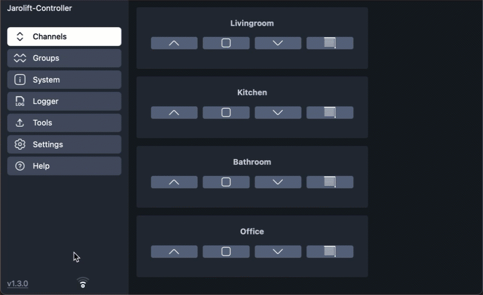

# Unreleased

- [FIX] Planned for v2.0.2 (`config.version=8`). Correct the internal base serial shift from 8 to 4 bits when adding the channel index to form the radio serial (#93). To compensate, the firmware converts the stored base serial once per configuration with `config.version<8` when upgrading or importing older backups.
- The six-digit base serial displayed in the WebUI can change. All 16 channel identities are preserved for installations on v2.0.0 or v2.0.1 and for installations before v2.0.0 with a base serial of `0FFFFF` or less. An installation before v2.0.0 with a higher base serial may need to pair its motors again.
- Export `config.json` before upgrading. If you return to an older release, restore the backup once the older firmware is running and restart before operating the shutters. Keep the current device counter stored separately in flash. See [Base serial migration](README.md#base-serial-migration).
- [IMPROVE] Confirm new OTA firmware after 30 seconds of uptime, including when offline.

---

# v2.0.1

This patch release fixes issues in v2.0.0. For the major changes, new features and migration notes, see [v2.0.0](https://github.com/dewenni/ESP32-Jarolift-Controller/releases/tag/v2.0.0).


- [FIX] Prevent ESP32-C3 startup stack overflow during configuration initialization when no valid configuration is available (#91)
- [FIX] Handle 0% and 100% positioning targets as endpoints without queueing full-duration moves
- [IMPROVE] Show calibrated positioning controls in the GitHub Pages demo
- [FIX] Select the configured language on first load
- [UPDATE] EspWebUI 0.0.14

---

# v2.0.0

Version 2.0.0 is a major release with a completely redesigned WebUI, calibrated percentage positioning and a new way to associate original remote controls with shutters. Radio reception has been significantly improved, alongside more reliable connections, updates and configuration storage.

## Highlights

### Calibrated shutter positioning

Set an opening target from **0% closed to 100% open** in the WebUI, via MQTT or through Home Assistant. Enable positioning globally under **Settings → Device**, then calibrate each desired shutter with the guided assistant on the **Service** page. Shutters without calibration remain usable with the normal UP, STOP, DOWN and SHADE buttons.

Separate opening and closing measurements account for the initial take-up time, the final slat closure and the changing winding diameter. Every percentage command first performs a full reference run to an endpoint, then moves to the requested opening. This avoids relying on a remembered position that may have changed through an original remote or a local wall switch.

All positions remain **time-based estimates without motor feedback**. Receiving original remote commands helps keep the status consistent, but cannot replace the reference run. The channel widgets show the estimated position with a compact shutter graphic and a separate target slider and execution button.

MQTT percentage targets use `<prefix>/cmd/position/N` with an integer payload from 0 to 100, without retain. Home Assistant Discovery adds percentage controls only for globally enabled, calibrated shutters and updates them when eligibility changes. WebUI, MQTT and Home Assistant share a fixed RAM queue for up to **16 waiting targets**, processed sequentially after the active run. New targets replace an existing waiting target for the same shutter. The WebUI marks pending targets with a spinner in the execute button and a compact queued-target label; the queue position is available in the button tooltip. Manual commands discard waiting targets; calibration remains exclusive. Group percentage positioning is not included.

See [Positioning and calibration](Doc/Positionierung.md) for the operating principle, calibration steps and MQTT/Home Assistant examples.

### Original remote controls: capture and associate per shutter

Original remotes are now managed directly on **Service** for the selected shutter. Capture an already paired single channel, confirm it with a second separate button press and give it a name. No remote model, manually entered serial number or channel mask is required.

- Up to **five associations per shutter**, with up to 80 distinct sources overall.
- Source names support up to **32 Unicode characters**.
- One source can be associated with multiple ESP shutters.
- Group commands automatically resolve the registered individual source channels; no separate group registration is needed.
- Removing an association affects only the selected shutter's ESP mapping, not the actual pairing at the motor.

Assigned remote commands update the shared WebUI/MQTT position estimate and cancel conflicting automatic movement sequences. Capturing a source does not transmit a motor pairing command; operating the original remote can still move its paired shutters.

### Significantly improved radio reception and more consistent transmission

The receive path has been improved through tuned CC1101 settings, better pulse validation and a **200 µs glitch filter** that merges short interference spikes. Frame completion and the final channel bit are now handled correctly, including **channel 16**. Incomplete frames and inconsistent discriminator values are rejected rather than passed on as apparent shutter commands.

Transmission now uses the ESP's **RMT peripheral** for consistent pulse timing. The configured transmit power is applied before CC1101 initialization. Detailed RF diagnostics are available at DEBUG level, while received commands remain visible at INFO level.

These changes substantially improve reception in practice, but do not guarantee reception of every remote or provide motor acknowledgements. See [RF reception](Doc/RF-Empfang.md) for the protocol and implemented filters.

### New WebUI style and clearer navigation

The interface has a new grey-blue theme with restrained warm accents, clearer typography and more consistent controls, tables and status displays. Desktop and mobile navigation, the network-status footer and the project-specific login page have also been revised.

Settings are organised into **General**, **Network**, **Integrations**, **Device**, and **Access & maintenance**. Related sections are kept together, with only one subsection expanded at a time. Home Assistant has its own integration section with a reminder that MQTT is required.

The **Tools** page clearly separates local firmware files from GitHub updates. GitHub version information and update execution now stay on the page instead of opening a separate version dialog.

The revised **Help** page provides German and English instructions for shutter operation, groups and timers, setup, positioning, original remotes, MQTT and connection reference information. Expandable sections make the guidance easier to navigate without leaving the device.

### WiFi network and access-point search

Separate search buttons list available **SSIDs** and **access points/BSSIDs** in selection dialogs. Hidden SSIDs can still be entered manually. Leave BSSID empty for automatic access-point selection, or select a fixed access point. Changing the SSID clears the previous BSSID binding.

### homee integration

Configured shutters can be exposed directly as virtual homee nodes with UP/DOWN/STOP, an optional SHADE button and firmware revision information. Enable and configure homee under **Settings → Integrations**. Compatibility mode uses the standard shutter profile; the optional third position uses an unknown node profile, which may be less compatible with some applications. This integration does not add calibrated percentage control to homee.

## Breaking changes and upgrade notes

### MQTT position status now means opening percentage

**`<prefix>/status/shutter/1` … `/16` now use 0 = fully closed and 100 = fully open. The previous scale was reversed.** Update manual MQTT cover configurations, numeric comparisons, automations and dashboards accordingly.

Intermediate values are estimated opening percentages. An unknown position is published as retained **`None`**, for example after restart, STOP or SHADE. No arbitrary intermediate shade position is assumed. MQTT reconnect republishes the current status to replace stale retained values.

The existing command identifiers are unchanged: on `cmd/shutter/N`, **`0` still means UP, `1` DOWN and `2` STOP**. They are not percentage values. Prefer `OPEN`/`CLOSE`/`STOP` where appropriate. On `cmd/position/N`, `0` means fully closed.

Refresh Home Assistant Discovery after upgrading existing installations. Discovery uses the new opening scale and is also refreshed on MQTT reconnect and when positioning eligibility changes. Unknown positions are not actual measurements; Home Assistant may retain its last known numeric position.

### Original remote associations have moved to Service

The old six-digit serial-prefix registration has been removed. Register the already paired **individual channels** on Service for the relevant shutters; groups are matched automatically.

Configuration version 7 migrates version-6 single-channel mappings and merges duplicate sources. Old explicit group mappings remain visible but inactive and must be replaced by capturing their individual channels. Older prefix-only registrations cannot be recovered and must be captured again. Physical motor pairing is unaffected. Imported associations above the new five-per-shutter limit are retained, but must be reduced before adding more to that shutter.

### WebUI and service credentials are separate

- **WebUI:** freely chosen username/password with optional authentication in normal operation.
- **Setup Mode:** fixed login **`admin` / `jarolift-2026!`**, independent of a missing or damaged configuration.
- **Telnet and remote ArduinoOTA:** use a separately configured, shared **service password**. Both remain disabled in normal operation while this password is empty. Telnet must additionally be enabled explicitly.
- **WebUI firmware updates and configuration import/export:** follow WebUI authentication and do not request an additional service password.

Old configurations without service settings leave Telnet and remote ArduinoOTA disabled. Configure the new service password under **Settings → Access & maintenance → Service access** if needed. For PlatformIO remote uploads, pass it with `upload_flags = --auth=<service-password>`.

In Setup Mode, remote ArduinoOTA uses `jarolift-2026!`. Telnet uses the same fixed password only if its enable setting is active; Setup Mode does not automatically enable Telnet. Disabling WebUI authentication does not disable service-password protection.

Back up the configuration before upgrading. Existing motor end positions do not replace the new positioning calibration; calibrate each shutter for which percentage control is desired.

## Further improvements

- Increased OTA update stability.
- More robust MQTT reconnects with increasing retry delays and recovery of the MQTT transport, without rebooting simply because the broker is unavailable.
- Improved WiFi recovery and WebSocket reconnection, including browser background-tab handling.
- Safer configuration saving through verified temporary files, retries and recovery after interrupted writes.
- Queued WebUI command processing, validation of MQTT payloads and fixes for configuration values containing formatting characters.
- Corrected motor learning-mode handling and validation of learning channels, with transmit serial numbers limited to the protocol's bit width.
- Improved validation of configuration values, including language selection, and immediate application of access settings after configuration imports.
- More useful system memory information, connection indicators and a clearer Logger interface with log-level colours and automatic refresh when opened.
- ESP32-S2 retains 128 diagnostic log entries instead of 200 to fit its internal RAM budget; other ESP32 variants retain 200 entries.
- Updated English and German documentation, screenshots and maintained host regression tests.

## Platform and library updates

- Arduino-ESP32 **3.3.12**, based on ESP-IDF **5.5.5** (pioarduino platform **55.03.312-1**).
- **EspWebUI 0.0.13**: shared settings navigation, themed login page and extended WebSocket integration.
- **ESPAsyncWebServer 3.12.1** and **AsyncTCP 3.6.1**.
- **ArduinoJson 7.4.3**.
- **EspStrUtil 1.1.0** and **EspSysUtil 1.1.0**.
- **homee-api-esp32 10.1.0** for the new homee integration.

## Thanks

Thanks to [@Oxi75](https://github.com/Oxi75) for the homee integration ([#79](https://github.com/dewenni/ESP32-Jarolift-Controller/pull/79)), [@kqfflo](https://github.com/kqfflo) for the RX/TX and learning fixes ([#90](https://github.com/dewenni/ESP32-Jarolift-Controller/pull/90)), and [@Reinhard-M](https://github.com/Reinhard-M) for the RF analysis, RMT and filtering work adapted from the [PositionController fork](https://github.com/Banabas/ESP32-Jarolift-PositionController), including [#20](https://github.com/Banabas/ESP32-Jarolift-PositionController/pull/20) and [#21](https://github.com/Banabas/ESP32-Jarolift-PositionController/pull/21).

---

# v1.9.1

## what's new

## changelog

- [UPDATE]  ESP32Async/ESPAsyncWebServer @ 3.7.6
- [UPDATE]  ESP32Async/AsyncTCP @ 3.3.8
- [UPDATE]  bblanchon/ArduinoJson @ 7.4.1
- [UPDATE]  dewenni/EspWebUI @ 0.0.7
- [IMPROVE] Automatically refresh Logger when the Logger Page is opened
- [IMPROVE] Colorize logger messages depending on log level

---

# v1.9.0

## what's new

### Service Commands

there is a new WebUI Page with service commands like:

- set shade
- set/delete upper end point
- set/delete lower end point

### remote signals (update)

The MQTT message for remote signals has been updated. The information about which shutter is controlled can be seen in the two variables `chBin` and `chDec`. `chBin` shows the used shutter as a 16-bit binary value, while `chDec` shows the same information as a decimal value for easier automation.

```json
topic:      ../status/remote/<serial-number>
payload:    {
              "name":   "<alias-name>", 
              "cmd":    "<UP, DOWN, STOP, SHADE>",
              "chBin":  "<channel-binary>",
              "chDec":  "<channel-decimal>"
            }
```

## changelog

- [FIX] bugfix github ota asset check #40, #45
- [FEATURE] service page with new service commands
- [FEATURE] new "unlearn" command in shutter settings
- [CHANGE] "set shade" was moved from settings to service page
- [CHANGE] MQTT messages for remote signals have been updated
- [CHANGE] internal redesign in JaroliftController-Lib
- [UPDATE] dewenni/EspWebUI @ 0.0.4

---

# v1.8.0

## what's new

### Timer: new option to set minimum or maximum time in combination with sunrise or sundown

Thanks to @blissi it is now possible to set additional minimum or maximum time in combination with sunrise or sundown.
You can therefore define that the shutter should open at sunrise, but not before 06:30, for example
Or close at sunset, but no later than 21:00

## changelog

- [UPDATE] dewenni/EspWebUI @ 0.0.2
- [FIX] bugfix github ota asset check #40
- [FEATURE] Timer: new option to set minimum or maximum time in combination with sunrise or sundown #41

---

# v1.7.0

## what's new

### EspWebUI-Library

with this update, the basic WebUI functions were outsourced to a separate [EspWebUI](https://github.com/dewenni/EspWebUI) library.
This should have no effect on the user experience, but it improves the handling of similar projects like [ESP_Buderus_KM271](https://github.com/dewenni/ESP_Buderus_KM271)

### support for received remote signals

As requested by some users, there is now also support for original remote controls. The signals from the remote controls are now captured, processed and also made available via MQTT. Further details can be found in the updated and extended readme.

### support for different ESP32 Chips

There is now also support for other ESP32 chips. This allows you a greater variance in the selection of your hardware.
For the newly supported chips, a firmware file for OTA updates and one for initial flashing will be offered in future. The direct GitHub update via the WebUI should also work for the new chips.

Supported Chips:

- ESP32
- ESP32-S2 (new)
- ESP32-S3 (new)
- ESP32-C3 (new)

### some minor WebUI improvements

- When a shutter command is executed in the WebUI, a message confirming the command is displayed for 2 seconds at the footer.
- Add additional ESP-Chip infos in the system section of the WebUI
- Add add additional error messages at the footer if Jarolift Keys or serial number not set

## changelog

- [UPDATE]  ESP32Async/AsyncTCP @ 3.3.6
- [UPDATE]  ESP32Async/ESPAsyncWebServer @ 3.7.2
- [UPDATE]  bblanchon/ArduinoJson @ 7.3.1
- [CHANGE] Basic WebUI functions were outsourced to a separate [EspWebUI](https://github.com/dewenni/EspWebUI) library
- [FIX] update WiFi and Ethernet Status also if mqtt is not connected
- [FIX] the entry of Jarolift Keys or the serial number was not accepted if you clicked on LOCK directly after the entry
- [FIX] skip websocket connection if WebUI is located on localhost or github.io
- [FEATURE] add additional error messages if Jarolift Keys or serial number not set
- [FEATURE] When a shutter command is executed in the WebUI, a message confirming the command is displayed for 2 seconds at the footer.
- [FEATURE] add support for received remote signals
- [FEATURE] add support for multiple ESP32 Chips
- [FEATURE] add additional ESP-Chip infos in the system section of the WebUI

---

# v1.6.2

## what's new

this is a minor bugfix version


## changelog

- [BUGFIX] Login problems due to faulty cookie handling fixed and improved #30

---

# v1.6.1

## what's new

this is a minor bugfix version

## changelog

- [BUGFIX] URL entries in the settings were not saved #29

---

# v1.6.0

## what's new

this is a minor update and bugfix version

### WebUI-Demo

For a first impression of the functions and the WebUI, a limited demo is also available.  
This can be accessed via the following link: [WebUI-DEMO](https://dewenni.github.io/ESP32-Jarolift-Controller/)

### Changed condition for Setup-Mode

Setup mode is now activated when the ESP is restarted **5** times.
A maximum of 5 seconds may elapse after each restart.

Example: restart 1/5 - wait 2s - restart 2/5 - wait 2s - restart 3/5 - wait 2s - restart 4/5 - wait 2s - restart /5/5 => Setup-Mode


## changelog

- [UPDATE]  ESP32Async/AsyncTCP @ 3.3.5
- [UPDATE]  ESP32Async/ESPAsyncWebServer @ 3.7.0
- [IMPROVE] Added validation for IP input fields in the setup area to avoid wrong syntax #27
- [IMPROVE] Conversion of the storage of the device counter from EEPROM to NVS
- [IMPROVE] remove callback function for internal messages in jarolift-controller library
- [IMPROVE] change "Double-Reset-Detection" to "Multi-Reset-Detection" now it needs 5 restarts within 5s timeout to enter Setup-Mode #26
- [NEW] Add a [WebUI-DEMO](https://dewenni.github.io/ESP32-Jarolift-Controller/) under github-pages
- [NEW] Added some description for possible teach-in procedures.

---

# v1.5.1

## what's new

this is a minor update and bugfix version

## changelog

- [UPDATE]  ESP32Async/AsyncTCP @ 3.3.2
- [UPDATE]  ESP32Async/ESPAsyncWebServer @ 3.6.2
- [UPDATE]  bblanchon/ArduinoJson @ 7.3.0
- [UPDATE]  dewenni/EspSysUtil @ 1.0.1
- [IMPROVE] add button for GitHub-OTA in Tools section #34
- [BUGFIX]  some log messages got lost at startup
- [BUGFIX]  WiFi Status information was not updated in webUI

---

# v1.5.0

## what's new

This update brings a cool new feature 🎉🎉🎉

### 1. Timer Control

The timer function enables the automatic control of individual roller shutters or a selection of several roller shutters as a group.
A fixed time can be specified as a trigger, or sunrise or sunset with an optional time offset.
This controller can therefore also work well as a stand-alone solution without the need for further automation


The selection of roller shutters is supported by an additional dialogue. All configured and activated roller shutters are displayed there. These can be selected there and the bitmask is then automatically created from them.


> [!TIP]
> Maybe it is necessary to clean your browser cache after the update, to be sure that everything works well!

### encrypted Passwords

Passwords are now better protected and stored in encrypted form in the config.json
When updating, the existing passwords are automatically encrypted and saved again.

> [!CAUTION]
> As the passwords are stored in encrypted form after this update, it is no longer possible to switch to an older version without re-entering the passwords after the downgrade

## changelog

- [UPDATE] Arduino core 3.1.1 based on IDF 5.3.2.241224
- [UPDATE] mathieucarbou/AsyncTCP @ 3.3.2
- [UPDATE] mathieucarbou/ESPAsyncWebServer @ 3.6.0
- [FEATURE] new feature to define 6 individual timer to automatically move the shutters #4
- [FEATURE] new wizard for defining bit masks for timers and groups
- [IMPROVE] uploaded config files via "config-upload" are now automatically renamed to config.json, regardless of the original filename.
- [IMPROVE] Improved behavior when the restart button is pressed immediately after a change in the settings.
- [IMPROVE] Passwords are better protected and are stored in encrypted form

---

# v1.4.0

## what's new

### 1. direct GitHub Update 🎉🎉🎉

This update introduces an exciting new feature:  
You can now update to the latest version directly from the WebUI – no need to download the .bin file manually anymore!

Simply click on the version info in the bottom left corner, and a dialog will open. If a new version is available, you can initiate the update right there. It will automatically download and install the latest release from GitHub.



### 2. new option to enable/disable WIFI

there is a new option to enable/disable WiFi. This could be useful if you use the Ethernet connection and you do not want to use the WiFi in parallel.
The depending switch to enable/disable is also in Settings > WiFi

> [!CAUTION]
> Unfortunately after the update the "enable" will be false and therefore the Controller will be activate the "Setup-Mode" after restart, because WiFi and in most cases Ethernet is now disabled. Then you have to connect to the Accesspoint, go to Settings and activate WiFi. After Reboot everything should be fine again. Sorry, but that's something I can't avoid in this case.

> [!TIP]
> Maybe it is necessary to clean your browser cache after the update, to be sure that everything works well!

## changelog

- add new feature to update directly from GitHub
- add option to enable/disable WIFI in case ETH is used (WiFi will be activated automatically in Setup-Mode) #17
- improve the size of controls at mobile layout

---

# v1.3.1

## what's new

minor changes and housekeeping

> [!NOTE]
> this project is still in an early phase.
> If you like this project, feel free to push the **[Star ⭐️]** button and click **[Watch 👁]** to stay updated.
> If there is any bug, please use the Issue function and let me know.
> If you have any further questions, suggestions or requests, please use the discussion function.

## changelog

- add group commands for telnet interface
- code cleanup (reorganize internal functions and libraries)
- add german description
- bugfix "Build fails on build_webui.py script with FileNotFoundError" #11

---

# v1.3.0

## what's new

This release brings group support for roller shutters. It is now possible to predefine up to 6 shutter groups. These groups can then be controlled with a command via the WebUI, MQTT or Home Assistant.
It is also possible to use a generic MQTT command to specify the selection of roller shutters for a group directly as a bitmask

### predefined Group

To control shutters a group you can use the following mqtt commands.
{UP, OPEN, 0} means, that you can use one of the listed payload commands.

```text

command:    group up
topic:      ../cmd/group/1 ... cmd/group/6
payload:    {UP, OPEN, 0}

command:    group down
topic:      ../cmd/group/1 ... cmd/group/6
payload:    {DOWN, CLOSE, 1}

command:    group stop
topic:      ../cmd/group/1 ... cmd/group/6
payload:    {STOP, 2}

command:    group shade
topic:      ../cmd/group/1 ... cmd/group/6
payload:    {SHADE, 3}

```

### Group with bitmask

You can also use a generic group command and provide the bitmask to select the shutters directly.  
The bitmask is a 16-bit number, with the least significant bit (on the right) representing channel 1.  
A set bit means that the channel belongs to this group.  

**Example**: `0000000000010101` means that channels 1, 3, and 5 belong to this group.

As payload, you can use three different formats to represent the same bitmask:

- **Binary**: `0b0000000000010101`
- **Hex**: `0x15`
- **Decimal**: `21`

```text

command:    group up
topic:      ../cmd/group/up
payload:    {0b0000000000010101, 0x15, 21}

command:    group down
topic:      ../cmd/group/down
payload:    {0b0000000000010101, 0x15, 21}

command:    group stop
topic:      ../cmd/group/stop
payload:    {0b0000000000010101, 0x15, 21}

command:    group shade
topic:      ../cmd/group/shade
payload:    {0b0000000000010101, 0x15, 21}

```

> [!NOTE]
> this project is still in an early phase.
> If you like this project, feel free to push the **[Star ⭐️]** button and click **[Watch 👁]** to stay updated.
> If there is any bug, please use the Issue function and let me know.
> If you have any further questions, suggestions or requests, please use the discussion function.

## changelog

- [FEATURE] highlight active page in the sidebar navigation
- [FEATURE] Implement Group Commands #6
- [FEATURE] HASS: ignore cover state (use optimistic=true) #8

---

# v1.2.0

## what's new

Implemented a command queue for incomming mqtt messages and also for the CC1101 commands.
Commands are now buffered and processed sequentially to prevent timing issues during transmission.

this project is still in an early phase.
If you like this project, feel free to push the **[Star ⭐️]** button and click **[Watch 👁]** to stay updated.
If there is any bug, please use the Issue function and let me know.
If you have any further questions, suggestions or requests, please use the discussion function.

## changelog

- fix missing SW-Version in MQTT-SysInfo and Home Assistant
- Implemented a command queue for incoming mqtt messages. #5
- Implemented a command queue for CC1101 to handle rapid consecutive commands to prevent timing issues during transmission. #5
- update to Arduino core 3.1.0 based on IDF 5.3.2.241210

---

# v1.1.1

## what's new

this is a minor bug fix version!

this project is still in an early phase.
If you like this project, feel free to push the **[Star ⭐️]** button and click **[Watch 👁]** to stay updated.
If there is any bug, please use the Issue function and let me know.
If you have any further questions, suggestions or requests, please use the discussion function.

## changelog

- extend internal check if cc1101 is connected to avoid infinite-loop #2


---

# v1.1.0

## what's new

minor changes and updates!

this project is still in an early phase.
If you like this project, feel free to push the **[Star ⭐️]** button and click **[Watch 👁]** to stay updated.
If there is any bug, please use the Issue function and let me know.
If you have any further questions, suggestions or requests, please use the discussion function.

## changelog

- add gpio check (check for duplicates and set initial values if gpio=0)
- set initial log level to "Debug"
- update mathieucarbou/AsyncTCP @ 3.3.1
- update mathieucarbou/ESPAsyncWebServer @ 3.4.3

---

# v1.0.0

## what's new

this is the initial release of this new project 🎉🎉🎉

If you like this project, feel free to push the **[Star ⭐️]** button and click **[Watch 👁]** to stay updated.

If there is any bug, please use the Issue function and let me know.

If you have any further questions, suggestions or requests, please use the discussion function.
