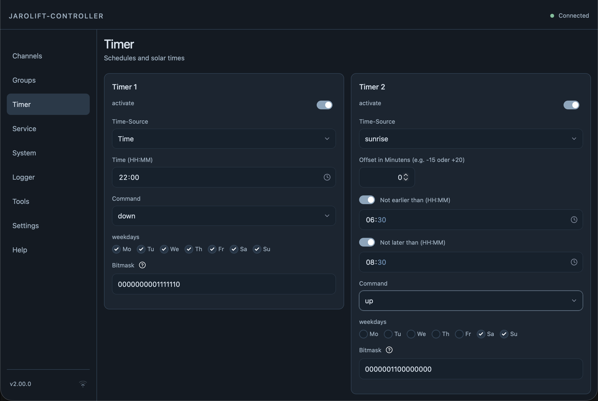
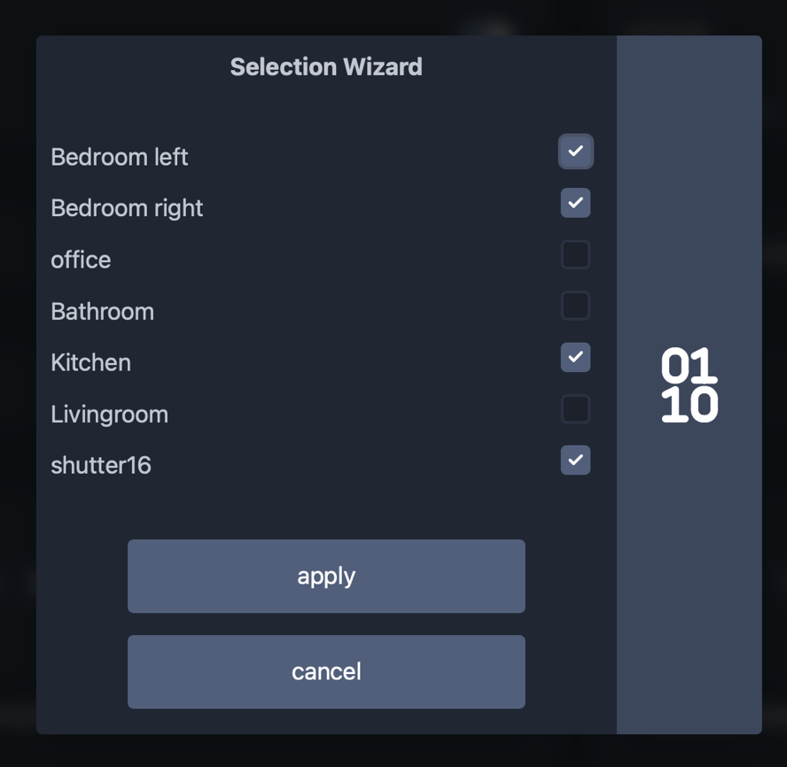

# Unreleased

## Breaking change: original remote mappings

The old six-digit prefix registration is removed. Settings → Device → Original remotes now contains a list with Add/Edit/Delete and signal capture. Each mapping uses the exact 28-bit serial (displayed as eight hex digits) **and** the received 16-bit channel mask, mapped to one or more ESP shutters. Single channels and groups sharing a serial therefore remain distinct. Up to 32 mappings are stored in configuration version 6. Legacy prefix mappings are discarded, not guessed or migrated: capture each required channel/group again. Existing radio pairing at the motors is unaffected. Deleting a row only deletes the ESP association. Capture does not transmit motor commands, but pressing the original remote may operate the shutters.

## Home Assistant percentage control

Eligible individual shutters expose `<prefix>/cmd/position/N` for integer opening targets 0..100. These use the same reference run and calibrated timing as the WebUI. Disabled, uncalibrated, busy or unavailable channels reject percentage commands. Publish commands without retain. Group percentage control is not included.

## Breaking change: unified shutter opening status

`<prefix>/status/shutter/1` … `/16` now use **0 = fully closed, 100 = fully open** (previously reversed). Intermediate numbers are estimated opening percentages. Update manual MQTT cover configurations, automations and dashboards; invert old numeric comparisons. Command payloads remain unchanged: `0` still means UP, `1` DOWN, `2` STOP; prefer OPEN/CLOSE/STOP to avoid confusion.

WebUI and MQTT now share one position estimate, including received commands from assigned original remotes and group commands. For calibrated shutters, manual UP/DOWN assumes the endpoint only after the full calibrated travel time plus reserve; repeated frames do not restart this timer. STOP, SHADE and interrupted automatic moves invalidate the estimate: retained MQTT payload `None` replaces stale positions. There is no assumed 10/90% shade position. Uncalibrated shutters still report the expected endpoint immediately for UP/DOWN. All values are estimates without motor feedback; missed remote signals remain undetectable.

MQTT reconnect republishes the current estimates (or `None` after restart) so old retained values cannot retain the previous scale. Home Assistant Discovery is adjusted to the new status definition; resend discovery after updating existing installations. Home Assistant additionally gets a percentage slider only for globally enabled, calibrated channels. Discovery is refreshed automatically on eligibility changes and MQTT reconnect. OPEN/CLOSE/STOP remain available for all configured shutters.

**Changelog**

# v1.10.0

## what's new

After a long absence, here's a major update with new features and improvements.

### homee smart home integration

Thanks to [@Oxi75 (Andreas)](https://github.com/Oxi75) for contributing the homee integration in [PR #79](https://github.com/dewenni/ESP32-Jarolift-Controller/pull/79).

The Jarolift Controller can now be integrated directly into [homee](https://hom.ee/). If enabled in the new "Homee" settings category, every configured shutter is registered as its own virtual homee node, with:

- a shutter switch (up/down/stop)
- an optional button for the 3rd position ("shade" / intermediate position)
- the firmware revision as an additional attribute

Only shutters that are actually configured (enabled) are registered as nodes. The name of the virtual homee itself is taken from the hostname configured under WiFi and is shown read-only in the settings page.

In compatibility mode, the standard shutter node profile of homee is used without a third position. Enabling the 3rd position creates a device with an "unknown" node profile, which may be less compatible with some applications.

If "enable homee" is left disabled, there is no change in behavior compared to before.

### password protection for Telnet and ArduinoOTA

Telnet connections and PlatformIO wireless uploads now require the password configured in the WebUI Auth settings, even when web authentication is disabled. If no password is configured, the shared fallback password is `jarolift-2026!`; set your own password in the WebUI. The same fallback is also used by the WebUI when authentication is enabled without a configured password.

For PlatformIO OTA uploads, supply `upload_flags = --auth=<password>` in addition to the device's `upload_port`. Telnet requires authentication again after reconnecting and disconnects clients that enter a wrong password.

### more reliable updates, connections and configuration storage

Browser firmware uploads are aborted after 60 seconds without progress, restoring the previous watchdog state. Network reconnects and related reboots are suspended during OTA updates. On installations with bootloader rollback support, new firmware is confirmed after two minutes of uptime with a network connection, or after ten minutes offline. A reboot before confirmation can trigger rollback to the previous firmware.

An unavailable MQTT broker no longer causes the controller to reboot. Reconnect attempts use an increasing delay of up to 60 seconds. WiFi recovery resets the WiFi stack periodically and only reboots as a last resort after about 30 minutes without a network connection.

Configuration changes are written to a temporary file and verified before replacing the previous configuration. Failed saves are retried. If the main configuration cannot be read at startup, a valid temporary save or upload file can be recovered.

### radio reception, learning and WebUI improvements

Thanks to [@kqfflo](https://github.com/kqfflo) for contributing the radio reception, TX serial packing and learning mode fixes in [PR #90](https://github.com/dewenni/ESP32-Jarolift-Controller/pull/90).

Radio frame capture and decoding have been corrected, including handling incomplete frames and protecting the receive buffer while decoding. Transmitted serial numbers are limited to the protocol's bit width so they cannot overwrite command bits. The selected learning mode is now preserved and applied correctly, with additional diagnostics for reception and learning.

The Logger page automatically refreshes when opened and displays messages in different colors depending on their log level. Settings now include English and German descriptions for homee, GPIOs, shutters, groups and remotes.

## changelog

- [FEATURE] add homee smart home integration with up/down/stop, optional shade button and firmware revision per enabled shutter ([#79](https://github.com/dewenni/ESP32-Jarolift-Controller/pull/79) by [@Oxi75](https://github.com/Oxi75))
- [FEATURE] require password authentication for Telnet and ArduinoOTA using the shared WebUI Auth password, with a fallback when no password is configured
- [FEATURE] defer OTA firmware confirmation to allow bootloader rollback before validation on supported installations
- [FIX] correct radio RX frame capture, synchronization between interrupt and loop, pulse validation and frame completion ([#90](https://github.com/dewenni/ESP32-Jarolift-Controller/pull/90) by [@kqfflo](https://github.com/kqfflo))
- [FIX] prevent TX serial bits from overwriting command bits and limit the base serial to 20 bits (#90 by @kqfflo)
- [FIX] preserve and apply the selected learning mode, reject invalid learning channels and correct repeated-stop detection (#90 by @kqfflo)
- [FIX] handle missing radio callbacks safely and initialize the radio in receive mode
- [FIX] treat WiFi and Ethernet settings as literal strings instead of format strings, including values containing percent characters
- [FIX] clamp language indices from configuration files and WebUI input to the supported range
- [FIX] preserve default authentication and logger settings when initializing a new configuration
- [FIX] reject invalid, oversized or fragmented MQTT commands instead of processing incomplete payloads
- [FIX] queue WebUI commands safely so consecutive commands do not overwrite each other before processing
- [FIX] abort stalled browser OTA uploads after 60 seconds without progress and restore the previous watchdog state
- [FIX] prevent overlapping OTA update paths and suspend WebUI command processing, MQTT processing and network reconnects during updates
- [FIX] keep the watchdog disabled in setup mode after GitHub OTA updates
- [FIX] apply authentication settings immediately after configuration imports and keep ArduinoOTA synchronized with password changes
- [FIX] save configuration through a verified temporary file, retain the previous file on failure and retry failed saves
- [FIX] recover valid temporary configuration or upload files when the main configuration is missing or invalid
- [IMPROVE] reconnect to MQTT with increasing delays up to 60 seconds without rebooting on broker outages
- [IMPROVE] recover WiFi with periodic stack resets, preserve static IP settings and delay the last-resort reboot until about 30 minutes offline
- [IMPROVE] automatically refresh the Logger page when opened and colorize messages by log level
- [IMPROVE] add English and German descriptions for homee, GPIO, shutter, group and remote settings
- [IMPROVE] add radio reception and learning diagnostics, with cryptographic key logging restricted to an explicit debug build option
- [UPDATE] Arduino Release v3.3.12 based on ESP-IDF v5.5.5
- [UPDATE] ESP32Async/ESPAsyncWebServer @ 3.12.1
- [UPDATE] ESP32Async/AsyncTCP @ 3.5.0
- [UPDATE] bblanchon/ArduinoJson @ 7.4.3
- [UPDATE] dewenni/EspWebUI @ 0.0.7 and refresh generated WebUI assets
- [UPDATE] add Oxi75/homee-api-esp32 @ 10.1.0
- [CHANGE] use ESP32 as the default PlatformIO build target and update the serial upload port example
- [CHANGE] add ESP32-C3 USB mode and USB CDC build flags
- [CHANGE] set the internal development version to v1.9.900 in preparation for v1.10.0
- [DOCS] document Telnet and OTA authentication, upload timeout and firmware rollback behavior
- [DOCS] add and update the stargazer chart in the English and German READMEs

---

# v1.9.1

## what's new

## changelog

- [UPDATE]  ESP32Async/ESPAsyncWebServer @ 3.7.6
- [UPDATE]  ESP32Async/AsyncTCP @ 3.3.8
- [UPDATE]  bblanchon/ArduinoJson @ 7.4.1
- [UPDATE]  dewenni/EspWebUI @ 0.0.7
- [IMPROVE] Automatically refresh Logger when the Logger Page is opened
- [IMPROVE] Colorize logger messages depending on log level

---

# v1.9.0

## what's new

### Service Commands

there is a new WebUI Page with service commands like:

- set shade
- set/delete upper end point
- set/delete lower end point

### remote signals (update)

The MQTT message for remote signals has been updated. The information about which shutter is controlled can be seen in the two variables `chBin` and `chDec`. `chBin` shows the used shutter as a 16-bit binary value, while `chDec` shows the same information as a decimal value for easier automation.

```json
topic:      ../status/remote/<serial-number>
payload:    {
              "name":   "<alias-name>", 
              "cmd":    "<UP, DOWN, STOP, SHADE>",
              "chBin":  "<channel-binary>",
              "chDec":  "<channel-decimal>"
            }
```

## changelog

- [FIX] bugfix github ota asset check #40, #45
- [FEATURE] service page with new service commands
- [FEATURE] new "unlearn" command in shutter settings
- [CHANGE] "set shade" was moved from settings to service page
- [CHANGE] MQTT messages for remote signals have been updated
- [CHANGE] internal redesign in JaroliftController-Lib
- [UPDATE] dewenni/EspWebUI @ 0.0.4

---

# v1.8.0

## what's new

### Timer: new option to set minimum or maximum time in combination with sunrise or sundown

Thanks to @blissi it is now possible to set additional minimum or maximum time in combination with sunrise or sundown.
You can therefore define that the shutter should open at sunrise, but not before 06:30, for example
Or close at sunset, but no later than 21:00

## changelog

- [UPDATE] dewenni/EspWebUI @ 0.0.2
- [FIX] bugfix github ota asset check #40
- [FEATURE] Timer: new option to set minimum or maximum time in combination with sunrise or sundown #41

---

# v1.7.0

## what's new

### EspWebUI-Library

with this update, the basic WebUI functions were outsourced to a separate [EspWebUI](https://github.com/dewenni/EspWebUI) library.
This should have no effect on the user experience, but it improves the handling of similar projects like [ESP_Buderus_KM271](https://github.com/dewenni/ESP_Buderus_KM271)

### support for received remote signals

As requested by some users, there is now also support for original remote controls. The signals from the remote controls are now captured, processed and also made available via MQTT. Further details can be found in the updated and extended readme.

### support for different ESP32 Chips

There is now also support for other ESP32 chips. This allows you a greater variance in the selection of your hardware.
For the newly supported chips, a firmware file for OTA updates and one for initial flashing will be offered in future. The direct GitHub update via the WebUI should also work for the new chips.

Supported Chips:

- ESP32
- ESP32-S2 (new)
- ESP32-S3 (new)
- ESP32-C3 (new)

### some minor WebUI improvements

- When a shutter command is executed in the WebUI, a message confirming the command is displayed for 2 seconds at the footer.
- Add additional ESP-Chip infos in the system section of the WebUI
- Add add additional error messages at the footer if Jarolift Keys or serial number not set

## changelog

- [UPDATE]  ESP32Async/AsyncTCP @ 3.3.6
- [UPDATE]  ESP32Async/ESPAsyncWebServer @ 3.7.2
- [UPDATE]  bblanchon/ArduinoJson @ 7.3.1
- [CHANGE] Basic WebUI functions were outsourced to a separate [EspWebUI](https://github.com/dewenni/EspWebUI) library
- [FIX] update WiFi and Ethernet Status also if mqtt is not connected
- [FIX] the entry of Jarolift Keys or the serial number was not accepted if you clicked on LOCK directly after the entry
- [FIX] skip websocket connection if WebUI is located on localhost or github.io
- [FEATURE] add additional error messages if Jarolift Keys or serial number not set
- [FEATURE] When a shutter command is executed in the WebUI, a message confirming the command is displayed for 2 seconds at the footer.
- [FEATURE] add support for received remote signals
- [FEATURE] add support for multiple ESP32 Chips
- [FEATURE] add additional ESP-Chip infos in the system section of the WebUI

---

# v1.6.2

## what's new

this is a minor bugfix version


## changelog

- [BUGFIX] Login problems due to faulty cookie handling fixed and improved #30

---

# v1.6.1

## what's new

this is a minor bugfix version

## changelog

- [BUGFIX] URL entries in the settings were not saved #29

---

# v1.6.0

## what's new

this is a minor update and bugfix version

### WebUI-Demo

For a first impression of the functions and the WebUI, a limited demo is also available.  
This can be accessed via the following link: [WebUI-DEMO](https://dewenni.github.io/ESP32-Jarolift-Controller/)

### Changed condition for Setup-Mode

Setup mode is now activated when the ESP is restarted **5** times.
A maximum of 5 seconds may elapse after each restart.

Example: restart 1/5 - wait 2s - restart 2/5 - wait 2s - restart 3/5 - wait 2s - restart 4/5 - wait 2s - restart /5/5 => Setup-Mode


## changelog

- [UPDATE]  ESP32Async/AsyncTCP @ 3.3.5
- [UPDATE]  ESP32Async/ESPAsyncWebServer @ 3.7.0
- [IMPROVE] Added validation for IP input fields in the setup area to avoid wrong syntax #27
- [IMPROVE] Conversion of the storage of the device counter from EEPROM to NVS
- [IMPROVE] remove callback function for internal messages in jarolift-controller library
- [IMPROVE] change "Double-Reset-Detection" to "Multi-Reset-Detection" now it needs 5 restarts within 5s timeout to enter Setup-Mode #26
- [NEW] Add a [WebUI-DEMO](https://dewenni.github.io/ESP32-Jarolift-Controller/) under github-pages
- [NEW] Added some description for possible teach-in procedures.

---

# v1.5.1

## what's new

this is a minor update and bugfix version

## changelog

- [UPDATE]  ESP32Async/AsyncTCP @ 3.3.2
- [UPDATE]  ESP32Async/ESPAsyncWebServer @ 3.6.2
- [UPDATE]  bblanchon/ArduinoJson @ 7.3.0
- [UPDATE]  dewenni/EspSysUtil @ 1.0.1
- [IMPROVE] add button for GitHub-OTA in Tools section #34
- [BUGFIX]  some log messages got lost at startup
- [BUGFIX]  WiFi Status information was not updated in webUI

---

# v1.5.0

## what's new

This update brings a cool new feature 🎉🎉🎉

### 1. Timer Control

The timer function enables the automatic control of individual roller shutters or a selection of several roller shutters as a group.
A fixed time can be specified as a trigger, or sunrise or sunset with an optional time offset.
This controller can therefore also work well as a stand-alone solution without the need for further automation



The selection of roller shutters is supported by an additional dialogue. All configured and activated roller shutters are displayed there. These can be selected there and the bitmask is then automatically created from them.



> [!TIP]
> Maybe it is necessary to clean your browser cache after the update, to be sure that everything works well!

### encrypted Passwords

Passwords are now better protected and stored in encrypted form in the config.json
When updating, the existing passwords are automatically encrypted and saved again.

> [!CAUTION]
> As the passwords are stored in encrypted form after this update, it is no longer possible to switch to an older version without re-entering the passwords after the downgrade

## changelog

- [UPDATE] Arduino core 3.1.1 based on IDF 5.3.2.241224
- [UPDATE] mathieucarbou/AsyncTCP @ 3.3.2
- [UPDATE] mathieucarbou/ESPAsyncWebServer @ 3.6.0
- [FEATURE] new feature to define 6 individual timer to automatically move the shutters #4
- [FEATURE] new wizard for defining bit masks for timers and groups
- [IMPROVE] uploaded config files via "config-upload" are now automatically renamed to config.json, regardless of the original filename.
- [IMPROVE] Improved behavior when the restart button is pressed immediately after a change in the settings.
- [IMPROVE] Passwords are better protected and are stored in encrypted form

---

# v1.4.0

## what's new

### 1. direct GitHub Update 🎉🎉🎉

This update introduces an exciting new feature:  
You can now update to the latest version directly from the WebUI – no need to download the .bin file manually anymore!

Simply click on the version info in the bottom left corner, and a dialog will open. If a new version is available, you can initiate the update right there. It will automatically download and install the latest release from GitHub.


### 2. new option to enable/disable WIFI

there is a new option to enable/disable WiFi. This could be useful if you use the Ethernet connection and you do not want to use the WiFi in parallel.
The depending switch to enable/disable is also in Settings > WiFi

> [!CAUTION]
> Unfortunately after the update the "enable" will be false and therefore the Controller will be activate the "Setup-Mode" after restart, because WiFi and in most cases Ethernet is now disabled. Then you have to connect to the Accesspoint, go to Settings and activate WiFi. After Reboot everything should be fine again. Sorry, but that's something I can't avoid in this case.

> [!TIP]
> Maybe it is necessary to clean your browser cache after the update, to be sure that everything works well!

## changelog

- add new feature to update directly from GitHub
- add option to enable/disable WIFI in case ETH is used (WiFi will be activated automatically in Setup-Mode) #17
- improve the size of controls at mobile layout

---

# v1.3.1

## what's new

minor changes and housekeeping

> [!NOTE]
> this project is still in an early phase.
> If you like this project, feel free to push the **[Star ⭐️]** button and click **[Watch 👁]** to stay updated.
> If there is any bug, please use the Issue function and let me know.
> If you have any further questions, suggestions or requests, please use the discussion function.

## changelog

- add group commands for telnet interface
- code cleanup (reorganize internal functions and libraries)
- add german description
- bugfix "Build fails on build_webui.py script with FileNotFoundError" #11

---

# v1.3.0

## what's new

This release brings group support for roller shutters. It is now possible to predefine up to 6 shutter groups. These groups can then be controlled with a command via the WebUI, MQTT or Home Assistant.
It is also possible to use a generic MQTT command to specify the selection of roller shutters for a group directly as a bitmask

### predefined Group

To control shutters a group you can use the following mqtt commands.
{UP, OPEN, 0} means, that you can use one of the listed payload commands.

```text

command:    group up
topic:      ../cmd/group/1 ... cmd/group/6
payload:    {UP, OPEN, 0}

command:    group down
topic:      ../cmd/group/1 ... cmd/group/6
payload:    {DOWN, CLOSE, 1}

command:    group stop
topic:      ../cmd/group/1 ... cmd/group/6
payload:    {STOP, 2}

command:    group shade
topic:      ../cmd/group/1 ... cmd/group/6
payload:    {SHADE, 3}

```

### Group with bitmask

You can also use a generic group command and provide the bitmask to select the shutters directly.  
The bitmask is a 16-bit number, with the least significant bit (on the right) representing channel 1.  
A set bit means that the channel belongs to this group.  

**Example**: `0000000000010101` means that channels 1, 3, and 5 belong to this group.

As payload, you can use three different formats to represent the same bitmask:

- **Binary**: `0b0000000000010101`
- **Hex**: `0x15`
- **Decimal**: `21`

```text

command:    group up
topic:      ../cmd/group/up
payload:    {0b0000000000010101, 0x15, 21}

command:    group down
topic:      ../cmd/group/down
payload:    {0b0000000000010101, 0x15, 21}

command:    group stop
topic:      ../cmd/group/stop
payload:    {0b0000000000010101, 0x15, 21}

command:    group shade
topic:      ../cmd/group/shade
payload:    {0b0000000000010101, 0x15, 21}

```

> [!NOTE]
> this project is still in an early phase.
> If you like this project, feel free to push the **[Star ⭐️]** button and click **[Watch 👁]** to stay updated.
> If there is any bug, please use the Issue function and let me know.
> If you have any further questions, suggestions or requests, please use the discussion function.

## changelog

- [FEATURE] highlight active page in the sidebar navigation
- [FEATURE] Implement Group Commands #6
- [FEATURE] HASS: ignore cover state (use optimistic=true) #8

---

# v1.2.0

## what's new

Implemented a command queue for incomming mqtt messages and also for the CC1101 commands.
Commands are now buffered and processed sequentially to prevent timing issues during transmission.

this project is still in an early phase.
If you like this project, feel free to push the **[Star ⭐️]** button and click **[Watch 👁]** to stay updated.
If there is any bug, please use the Issue function and let me know.
If you have any further questions, suggestions or requests, please use the discussion function.

## changelog

- fix missing SW-Version in MQTT-SysInfo and Home Assistant
- Implemented a command queue for incoming mqtt messages. #5
- Implemented a command queue for CC1101 to handle rapid consecutive commands to prevent timing issues during transmission. #5
- update to Arduino core 3.1.0 based on IDF 5.3.2.241210

---

# v1.1.1

## what's new

this is a minor bug fix version!

this project is still in an early phase.
If you like this project, feel free to push the **[Star ⭐️]** button and click **[Watch 👁]** to stay updated.
If there is any bug, please use the Issue function and let me know.
If you have any further questions, suggestions or requests, please use the discussion function.

## changelog

- extend internal check if cc1101 is connected to avoid infinite-loop #2


---

# v1.1.0

## what's new

minor changes and updates!

this project is still in an early phase.
If you like this project, feel free to push the **[Star ⭐️]** button and click **[Watch 👁]** to stay updated.
If there is any bug, please use the Issue function and let me know.
If you have any further questions, suggestions or requests, please use the discussion function.

## changelog

- add gpio check (check for duplicates and set initial values if gpio=0)
- set initial log level to "Debug"
- update mathieucarbou/AsyncTCP @ 3.3.1
- update mathieucarbou/ESPAsyncWebServer @ 3.4.3

---

# v1.0.0

## what's new

this is the initial release of this new project 🎉🎉🎉

If you like this project, feel free to push the **[Star ⭐️]** button and click **[Watch 👁]** to stay updated.

If there is any bug, please use the Issue function and let me know.

If you have any further questions, suggestions or requests, please use the discussion function.
